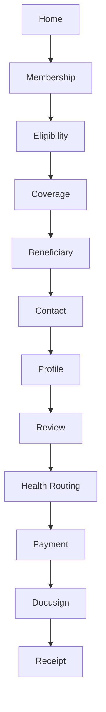
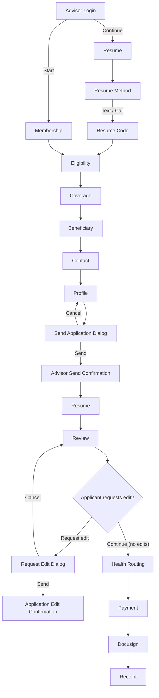
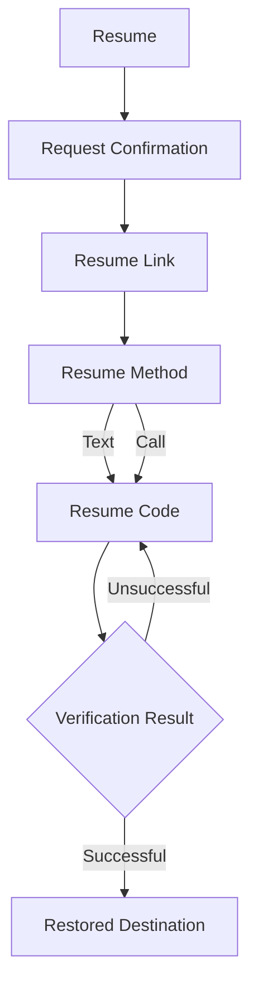
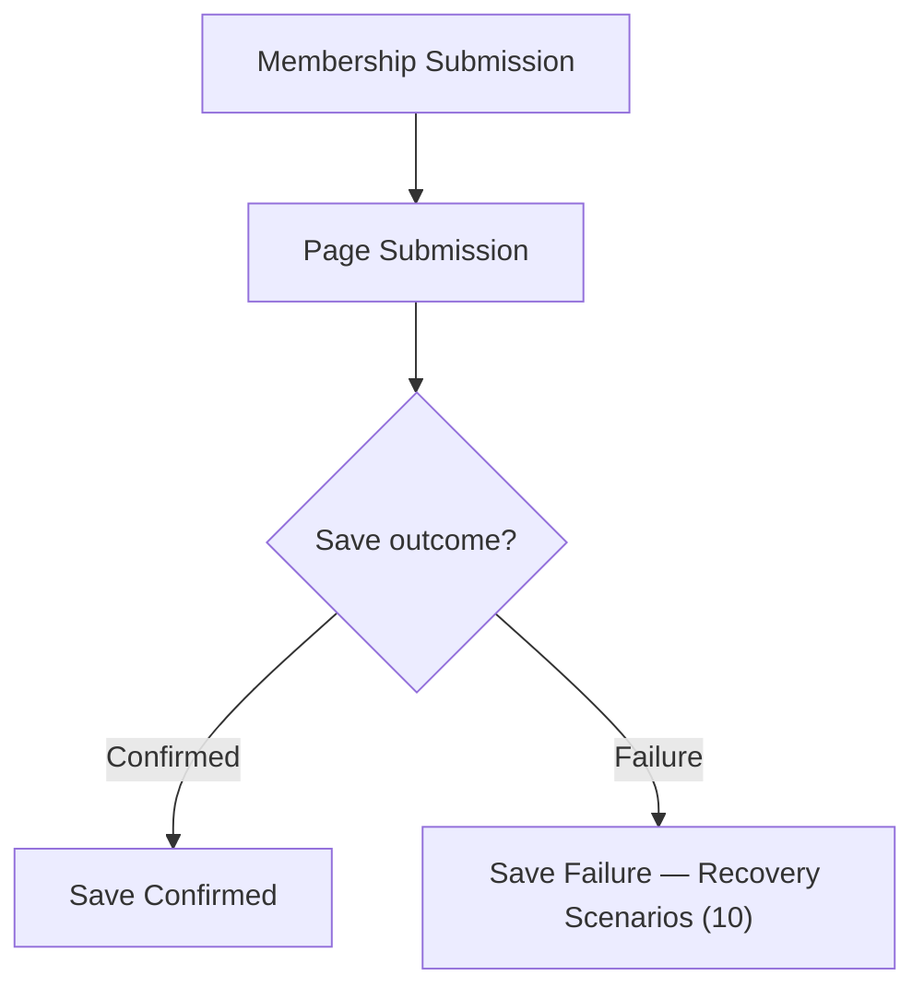
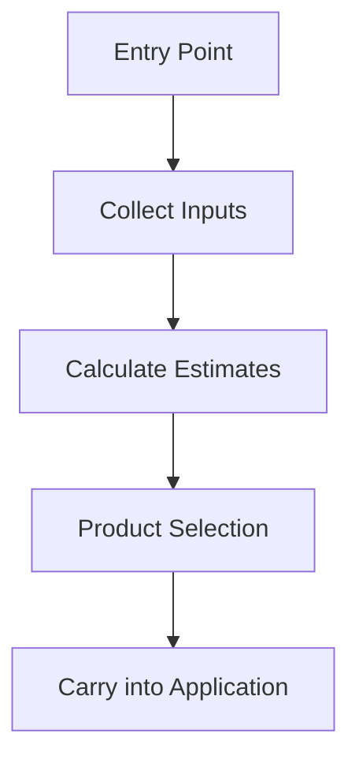
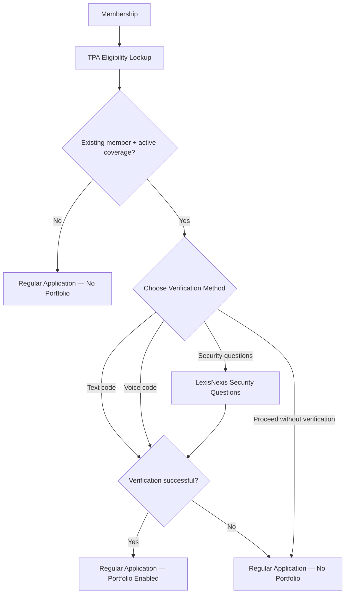

# ABE Portal Library requirements

October 22, 2026. What ABE currently does in the new template.

The shared source is [the JSON catalog](../../public/catalog/portal.json). The prototype and Library read this file. Pages, Fields and Components tables below are generated from the same catalog with `npm run docs:abe`; usage, visibility and validation remain separate. Updates to the deployed catalog take effect after redeployment. Local saved Site drafts are previews and are not included in these catalog tables.

## Client information

| Item | ABE |
| --- | --- |
| Name | American Bar Endowment |
| Site | `abe` |
| Applicants | Member, spouse and children |
| Phone | (800) 621-8981 |
| Email | information@abendowment.org |
| Website | abendowment.org |
| Address | 321 North Clark Street, 14th Floor, Chicago, IL 60654-7648 |

## Pages

Applicable ABE pages from the saved page catalog and Site assignments. Application, resume and advisor pages are all pages in this catalog. Page sequencing is a navigation rule for each flow, documented under Business rules and shown in Flows. Collection requirements are defined under Configurations.

<!-- ABE-PAGE-CATALOG:START -->
| ID | Page name | Route | Flow |
| --- | --- | --- | --- |
| `home` | Home | `/` | Application |
| `membership` | Membership | `/membership` | Application |
| `eligibility` | Eligibility | `/eligibility` | Application |
| `coverage` | Coverage | `/coverage` | Application |
| `beneficiary` | Beneficiary | `/beneficiary` | Application |
| `contact` | Contact | `/contact` | Application |
| `profile` | Profile | `/profile` | Application |
| `review` | Review | `/review` | Application |
| `health-li` | Health LI | `/health-li` | Application |
| `health-qd` | Health QD | `/health-qd` | Application |
| `health-di` | Health DI | `/health-di` | Application |
| `health-ci` | Health CI | `/health-ci` | Application |
| `payment` | Payment | `/payment` | Application |
| `docusign` | Docusign | `/docusign` | Application |
| `receipt` | Receipt | `/receipt` | Application |
| `resume` | Resume | `/resume` | Resume |
| `resume-method` | Resume Method | `/resume-method` | Resume |
| `resume-code` | Resume Code | `/resume-code` | Resume |
| `advisor-login` | Advisor Login | `/advisor-login` | Advisor |
| `advisor-send-confirmation` | Advisor Send Confirmation | `/advisor-send-confirmation` | Advisor |
| `application-edit-confirmation` | Application Edit Confirmation | `/application-edit-confirmation` | Advisor |
| `error-404` | Error 404 | `/404` | Utility |
| `error-500` | Error 500 | `/500` | Utility |
| `session-expired` | Session Expired | `/session-expired` | Utility |
| `technical-error` | Technical Error | `/technical-error` | Utility |
| `maintenance` | Maintenance | `/maintenance` | Utility |
| `application-unavailable` | Application unavailable | `/application-unavailable` | Utility |
| `outcome-unknown` | Unconfirmed payment/submission result | `/outcome-unknown` | Utility |
<!-- ABE-PAGE-CATALOG:END -->

Health routes are shown according to the selected coverage and processing outcome.

### Health page layout

Each health questionnaire has one page for both adults. The layout is:

```text
Question 1
  Member
    Member answer fields
    Member follow-up fields after Yes
  Spouse
    Spouse answer fields
    Spouse follow-up fields after Yes

Question 2
  Member
    Member answer fields
  Spouse
    Spouse answer fields
```

Only the adult who needs a question is shown. Applicant headings use the standard ApplicantSectionDivider component and shouldShowApplicantLabel rule: hide the heading for member-only applications; show the standard headings for member-and-spouse applications. Member and spouse answers and detail records remain separate. Corresponding CI-only/combined questions share a question group while keeping their original wording and answer IDs. Different DI forms are not merged into the same question.

This applies to Health Life, Health DI and Health CI for ABE. QD and E-Sign remain simulated steps. ABE does not enable the separate CIR health page, including when R28 is selected. R28 requires that adult's Term Life coverage; the existing Life-health routing and updated forms are preserved. The one supplied CHR questionnaire remains available to Sites configured for CIR health questions and appears only for an adult selecting CIR.

The prototype and Library page references use the same saved page definitions and Site assignments. This includes Pages, Fields, Validation, Analytics, Site Preview and the page references within Flows. Saved routes, order and availability are reflected when the prototype is reloaded or the Library is refreshed.

## Flows

The Library reads its diagrams from the saved flow records. Page names and availability come from the same page catalog and ABE assignments as the prototype. Health Routing lists the enabled health pages for ABE. The existing nodes and connections are preserved. Stored diagrams use `flows`, `flow_steps`, `flow_transitions` and `site_flows`.

### Consumer Application Flow

Authoring reference: [existing Library definition](../../src/content/docs/flows/consumerFlow.ts).



### Advisor-Assisted Flow

Authoring reference: [existing Library definition](../../src/content/docs/flows/advisorFlow.ts).



### Resume & Verification Flow

Authoring reference: [existing Library definition](../../src/content/docs/flows/resumeFlow.ts).



### Autosave & Persistence Flow

Authoring reference: [existing Library definition](../../src/content/docs/flows/autosaveFlow.ts).



### Quote Flow

Authoring reference: [existing Library definition](../../src/content/docs/flows/quoteFlow.ts).



### TPA Member Verification Flow

Authoring reference: [existing Library definition](../../src/content/docs/flows/tpaVerificationFlow.ts).



## Fields

### Field catalog

One row per saved field ID used by ABE. Labels, input types, formats and options are resolved from the same saved definitions as the prototype and Library. A consistent ABE override is shown here; differences between placements belong in usage. Required status, visibility and sequencing are documented under Business rules and Validation.

<!-- ABE-FIELD-CATALOG:START -->
| ID | Label | Input type | Format | Options |
| --- | --- | --- | --- | --- |
| `membership` | Are you an active member of a State, Local, or Specialty Bar Association? | radio | — | Yes; No |
| `first-name` | First Name | text | — | — |
| `last-name` | Last Name | text | — | — |
| `email` | Email | text | email | — |
| `phone` | Phone Number | text | phone | — |
| `phone-type` | Phone Type | dropdown | — | Mobile; Home; Business |
| `zip-postal-code` | Zip / Postal Code | text | — | — |
| `state-province` | State / Province | searchable-select | — | Alabama (AL); Alaska (AK); Alberta (AB); Arizona (AZ); Arkansas (AR); British Columbia (BC); California (CA); Colorado (CO); Connecticut (CT); Delaware (DE); District of Columbia (DC); Florida (FL); Georgia (GA); Guam (GU); Hawaii (HI); Idaho (ID); Illinois (IL); Indiana (IN); Iowa (IA); Kansas (KS); Kentucky (KY); Louisiana (LA); Maine (ME); Manitoba (MB); Maryland (MD); Massachusetts (MA); Michigan (MI); Minnesota (MN); Mississippi (MS); Missouri (MO); Montana (MT); New Brunswick (NB); Nebraska (NE); Nevada (NV); New Hampshire (NH); New Jersey (NJ); Newfoundland and Labrador (NL); New Mexico (NM); New York (NY); North Carolina (NC); North Dakota (ND); Northwest Territories (NT); Nova Scotia (NS); Nunavut (NU); Ohio (OH); Oklahoma (OK); Ontario (ON); Oregon (OR); Pennsylvania (PA); Prince Edward Island (PE); Puerto Rico (PR); Quebec (QC); Rhode Island (RI); Saskatchewan (SK); South Carolina (SC); South Dakota (SD); Tennessee (TN); Texas (TX); Utah (UT); Vermont (VT); Virgin Islands (VI); Virginia (VA); Washington (WA); West Virginia (WV); Wisconsin (WI); Wyoming (WY); Yukon Territory (YT) |
| `birth-date` | Date of Birth | date | — | — |
| `dependents` | Would you like to add dependent coverage? | checkbox-group | — | Spouse; Child |
| `spouse-first-name` | First Name | text | — | — |
| `spouse-last-name` | Last Name | text | — | — |
| `spouse-birth-date` | Date of Birth | date | — | — |
| `child-first-name` | First Name | text | — | — |
| `child-last-name` | Last Name | text | — | — |
| `child-birth-date` | Date of Birth | date | — | — |
| `child-gender` | Gender | radio | — | Male; Female |
| `gender` | Gender | radio | — | Male; Female |
| `smoker` | Have you used tobacco or any nicotine substitute in any form (including nicotine patches and nicotine chewing gum)? | radio | — | Yes; No |
| `tobacco-last-used` | Last Used | date | — | — |
| `tobacco-products` | Product(s) Used | multi-select | — | Cigarettes; Nicotine patch; Nicotine inhaler; Nasal spray; Nicotine gum; Nicotine lozenge; E-Cigarettes; Cigar (Cigars); Pipe; Chewing tobacco; Snuff; Betel nut |
| `average-monthly-income` | Average Monthly Income | text | currency | — |
| `actively-at-work` | Are you actively at work performing the normal duties of your occupation? | radio | — | Yes; No |
| `hours-worked-per-week` | # Hours You Work/Week | number | — | — |
| `monthly-business-expenses` | Monthly Business Expenses | text | currency | — |
| `business-expense-responsibility` | % You Are Responsible For | text | percent | — |
| `spouse-membership` | Is your spouse also an active member of a State, Local, or Specialty Bar Association? | radio | — | Yes; No |
| `spouse-gender` | Gender | radio | — | Male; Female |
| `spouse-smoker` | Have you used tobacco or any nicotine substitute in any form (including nicotine patches and nicotine chewing gum)? | radio | — | Yes; No |
| `spouse-tobacco-last-used` | Last Used | date | — | — |
| `spouse-tobacco-products` | Product(s) Used | multi-select | — | Cigarettes; Nicotine patch; Nicotine inhaler; Nasal spray; Nicotine gum; Nicotine lozenge; E-Cigarettes; Cigar (Cigars); Pipe; Chewing tobacco; Snuff; Betel nut |
| `spouse-average-monthly-income` | Average Monthly Income | text | currency | — |
| `spouse-hours-worked-per-week` | # Hours You Work/Week | number | — | — |
| `spouse-phone` | Phone Number | text | phone | — |
| `spouse-phone-type` | Phone Type | dropdown | — | Mobile; Home; Business |
| `spouse-email` | Email | text | email | — |
| `street-address` | Street Address | text | — | — |
| `apt-suite` | Apt/Suite | text | — | — |
| `city` | City | text | — | — |
| `state` | State | searchable-select | — | Alabama (AL); Alaska (AK); Alberta (AB); Arizona (AZ); Arkansas (AR); British Columbia (BC); California (CA); Colorado (CO); Connecticut (CT); Delaware (DE); District of Columbia (DC); Florida (FL); Georgia (GA); Guam (GU); Hawaii (HI); Idaho (ID); Illinois (IL); Indiana (IN); Iowa (IA); Kansas (KS); Kentucky (KY); Louisiana (LA); Maine (ME); Manitoba (MB); Maryland (MD); Massachusetts (MA); Michigan (MI); Minnesota (MN); Mississippi (MS); Missouri (MO); Montana (MT); New Brunswick (NB); Nebraska (NE); Nevada (NV); New Hampshire (NH); New Jersey (NJ); Newfoundland and Labrador (NL); New Mexico (NM); New York (NY); North Carolina (NC); North Dakota (ND); Northwest Territories (NT); Nova Scotia (NS); Nunavut (NU); Ohio (OH); Oklahoma (OK); Ontario (ON); Oregon (OR); Pennsylvania (PA); Prince Edward Island (PE); Puerto Rico (PR); Quebec (QC); Rhode Island (RI); Saskatchewan (SK); South Carolina (SC); South Dakota (SD); Tennessee (TN); Texas (TX); Utah (UT); Vermont (VT); Virgin Islands (VI); Virginia (VA); Washington (WA); West Virginia (WV); Wisconsin (WI); Wyoming (WY); Yukon Territory (YT) |
| `zip-code` | Zip / Postal Code | text | — | — |
| `correspondence-to` | Where should we send correspondence regarding your application? | radio | — | Home Address (residential); Business Address (business) |
| `business-name` | Name of Business or Employer | text | — | — |
| `business-type` | Type of Business | radio | — | Sole Proprietor (sole-proprietor); Corporation; Partnership |
| `business-address-same-as-home` | Business address is the same as home address | checkbox | — | — |
| `business-street-address` | Business Street Address | text | — | — |
| `business-apt-suite` | Apt/Suite | text | — | — |
| `business-city` | City | text | — | — |
| `business-state` | State | searchable-select | — | Alabama (AL); Alaska (AK); Alberta (AB); Arizona (AZ); Arkansas (AR); British Columbia (BC); California (CA); Colorado (CO); Connecticut (CT); Delaware (DE); District of Columbia (DC); Florida (FL); Georgia (GA); Guam (GU); Hawaii (HI); Idaho (ID); Illinois (IL); Indiana (IN); Iowa (IA); Kansas (KS); Kentucky (KY); Louisiana (LA); Maine (ME); Manitoba (MB); Maryland (MD); Massachusetts (MA); Michigan (MI); Minnesota (MN); Mississippi (MS); Missouri (MO); Montana (MT); New Brunswick (NB); Nebraska (NE); Nevada (NV); New Hampshire (NH); New Jersey (NJ); Newfoundland and Labrador (NL); New Mexico (NM); New York (NY); North Carolina (NC); North Dakota (ND); Northwest Territories (NT); Nova Scotia (NS); Nunavut (NU); Ohio (OH); Oklahoma (OK); Ontario (ON); Oregon (OR); Pennsylvania (PA); Prince Edward Island (PE); Puerto Rico (PR); Quebec (QC); Rhode Island (RI); Saskatchewan (SK); South Carolina (SC); South Dakota (SD); Tennessee (TN); Texas (TX); Utah (UT); Vermont (VT); Virgin Islands (VI); Virginia (VA); Washington (WA); West Virginia (WV); Wisconsin (WI); Wyoming (WY); Yukon Territory (YT) |
| `business-zip-code` | Zip Code | text | — | — |
| `business-phone` | Business Phone Number | text | phone | — |
| `physician-first-name` | Physician First Name | text | — | — |
| `physician-last-name` | Physician Last Name | text | — | — |
| `physician-phone` | Physician Phone Number | text | phone | — |
| `medical-facility-name` | Medical Facility Name | text | — | — |
| `medical-facility-street-address` | Street Address | text | — | — |
| `medical-facility-apt-suite` | Apt/Suite | text | — | — |
| `medical-city` | City | text | — | — |
| `medical-state` | State | searchable-select | — | Alabama (AL); Alaska (AK); Alberta (AB); Arizona (AZ); Arkansas (AR); British Columbia (BC); California (CA); Colorado (CO); Connecticut (CT); Delaware (DE); District of Columbia (DC); Florida (FL); Georgia (GA); Guam (GU); Hawaii (HI); Idaho (ID); Illinois (IL); Indiana (IN); Iowa (IA); Kansas (KS); Kentucky (KY); Louisiana (LA); Maine (ME); Manitoba (MB); Maryland (MD); Massachusetts (MA); Michigan (MI); Minnesota (MN); Mississippi (MS); Missouri (MO); Montana (MT); New Brunswick (NB); Nebraska (NE); Nevada (NV); New Hampshire (NH); New Jersey (NJ); Newfoundland and Labrador (NL); New Mexico (NM); New York (NY); North Carolina (NC); North Dakota (ND); Northwest Territories (NT); Nova Scotia (NS); Nunavut (NU); Ohio (OH); Oklahoma (OK); Ontario (ON); Oregon (OR); Pennsylvania (PA); Prince Edward Island (PE); Puerto Rico (PR); Quebec (QC); Rhode Island (RI); Saskatchewan (SK); South Carolina (SC); South Dakota (SD); Tennessee (TN); Texas (TX); Utah (UT); Vermont (VT); Virgin Islands (VI); Virginia (VA); Washington (WA); West Virginia (WV); Wisconsin (WI); Wyoming (WY); Yukon Territory (YT) |
| `medical-zip-code` | Zip Code | text | — | — |
| `height-feet` | Height (Feet) | number | — | — |
| `height-inches` | Inches | number | — | — |
| `weight-lbs` | Weight (lbs.) | number | — | — |
| `weight-12-months-ago-lbs` | Weight 12 Mos. Ago | number | — | — |
| `social-security-number` | Social Security Number | text | ssn | — |
| `marital-status` | Marital Status | dropdown | — | Single; Married; Divorced; Widowed; Separated |
| `has-drivers-license` | Do you have a valid driver's license? | radio | — | Yes; No |
| `drivers-license-number` | Driver's License Number | text | — | — |
| `drivers-license-state` | Driver's License State | searchable-select | — | Alabama (AL); Alaska (AK); Alberta (AB); Arizona (AZ); Arkansas (AR); British Columbia (BC); California (CA); Colorado (CO); Connecticut (CT); Delaware (DE); District of Columbia (DC); Florida (FL); Georgia (GA); Guam (GU); Hawaii (HI); Idaho (ID); Illinois (IL); Indiana (IN); Iowa (IA); Kansas (KS); Kentucky (KY); Louisiana (LA); Maine (ME); Manitoba (MB); Maryland (MD); Massachusetts (MA); Michigan (MI); Minnesota (MN); Mississippi (MS); Missouri (MO); Montana (MT); New Brunswick (NB); Nebraska (NE); Nevada (NV); New Hampshire (NH); New Jersey (NJ); Newfoundland and Labrador (NL); New Mexico (NM); New York (NY); North Carolina (NC); North Dakota (ND); Northwest Territories (NT); Nova Scotia (NS); Nunavut (NU); Ohio (OH); Oklahoma (OK); Ontario (ON); Oregon (OR); Pennsylvania (PA); Prince Edward Island (PE); Puerto Rico (PR); Quebec (QC); Rhode Island (RI); Saskatchewan (SK); South Carolina (SC); South Dakota (SD); Tennessee (TN); Texas (TX); Utah (UT); Vermont (VT); Virgin Islands (VI); Virginia (VA); Washington (WA); West Virginia (WV); Wisconsin (WI); Wyoming (WY); Yukon Territory (YT) |
| `intend-live-outside-us` | Do you intend to live outside the United States? | radio | — | Yes; No |
| `outside-us-months` | How many months? | number | — | — |
| `outside-us-country` | Country | dropdown | — | Canada; Mexico; United Kingdom (united-kingdom); France; Germany; Japan; Australia; Other |
| `travel-outside-us-six-months` | Will you travel outside the U.S. for 6+ months in the next year? | radio | — | Yes; No |
| `travel-outside-us-country` | Country | dropdown | — | Canada; Mexico; United Kingdom (united-kingdom); France; Germany; Japan; Australia; Other |
| `spouse-height-feet` | Height (Feet) | number | — | — |
| `spouse-height-inches` | Inches | number | — | — |
| `spouse-weight-lbs` | Weight (lbs.) | number | — | — |
| `spouse-weight-12-months-ago-lbs` | Weight 12 Mos. Ago | number | — | — |
| `spouse-social-security-number` | Social Security Number | text | ssn | — |
| `spouse-has-drivers-license` | Does your spouse have a valid driver's license? | radio | — | Yes; No |
| `spouse-drivers-license-number` | Spouse Driver's License Number | text | — | — |
| `spouse-drivers-license-state` | Spouse Driver's License State | searchable-select | — | Alabama (AL); Alaska (AK); Alberta (AB); Arizona (AZ); Arkansas (AR); British Columbia (BC); California (CA); Colorado (CO); Connecticut (CT); Delaware (DE); District of Columbia (DC); Florida (FL); Georgia (GA); Guam (GU); Hawaii (HI); Idaho (ID); Illinois (IL); Indiana (IN); Iowa (IA); Kansas (KS); Kentucky (KY); Louisiana (LA); Maine (ME); Manitoba (MB); Maryland (MD); Massachusetts (MA); Michigan (MI); Minnesota (MN); Mississippi (MS); Missouri (MO); Montana (MT); New Brunswick (NB); Nebraska (NE); Nevada (NV); New Hampshire (NH); New Jersey (NJ); Newfoundland and Labrador (NL); New Mexico (NM); New York (NY); North Carolina (NC); North Dakota (ND); Northwest Territories (NT); Nova Scotia (NS); Nunavut (NU); Ohio (OH); Oklahoma (OK); Ontario (ON); Oregon (OR); Pennsylvania (PA); Prince Edward Island (PE); Puerto Rico (PR); Quebec (QC); Rhode Island (RI); Saskatchewan (SK); South Carolina (SC); South Dakota (SD); Tennessee (TN); Texas (TX); Utah (UT); Vermont (VT); Virgin Islands (VI); Virginia (VA); Washington (WA); West Virginia (WV); Wisconsin (WI); Wyoming (WY); Yukon Territory (YT) |
| `spouse-intend-live-outside-us` | Does your spouse intend to reside outside the U.S. or Canada within the next 12 months? | radio | — | Yes; No |
| `spouse-outside-us-months` | How many months? | number | — | — |
| `spouse-outside-us-country` | Country | dropdown | — | Canada; Mexico; United Kingdom (united-kingdom); France; Germany; Japan; Australia; Other |
| `spouse-travel-outside-us-six-months` | Does your spouse intend to travel outside the U.S. or Canada within the next 12 months? | radio | — | Yes; No |
| `spouse-travel-outside-us-country` | Country | dropdown | — | Canada; Mexico; United Kingdom (united-kingdom); France; Germany; Japan; Australia; Other |
| `spouse-physician-first-name` | Physician First Name | text | — | — |
| `spouse-physician-last-name` | Physician Last Name | text | — | — |
| `spouse-physician-phone` | Physician Phone Number | text | phone | — |
| `spouse-medical-facility-name` | Medical Facility Name | text | — | — |
| `spouse-medical-facility-street-address` | Street Address | text | — | — |
| `spouse-medical-facility-apt-suite` | Apt/Suite | text | — | — |
| `spouse-medical-city` | City | text | — | — |
| `spouse-medical-state` | State | searchable-select | — | Alabama (AL); Alaska (AK); Alberta (AB); Arizona (AZ); Arkansas (AR); British Columbia (BC); California (CA); Colorado (CO); Connecticut (CT); Delaware (DE); District of Columbia (DC); Florida (FL); Georgia (GA); Guam (GU); Hawaii (HI); Idaho (ID); Illinois (IL); Indiana (IN); Iowa (IA); Kansas (KS); Kentucky (KY); Louisiana (LA); Maine (ME); Manitoba (MB); Maryland (MD); Massachusetts (MA); Michigan (MI); Minnesota (MN); Mississippi (MS); Missouri (MO); Montana (MT); New Brunswick (NB); Nebraska (NE); Nevada (NV); New Hampshire (NH); New Jersey (NJ); Newfoundland and Labrador (NL); New Mexico (NM); New York (NY); North Carolina (NC); North Dakota (ND); Northwest Territories (NT); Nova Scotia (NS); Nunavut (NU); Ohio (OH); Oklahoma (OK); Ontario (ON); Oregon (OR); Pennsylvania (PA); Prince Edward Island (PE); Puerto Rico (PR); Quebec (QC); Rhode Island (RI); Saskatchewan (SK); South Carolina (SC); South Dakota (SD); Tennessee (TN); Texas (TX); Utah (UT); Vermont (VT); Virgin Islands (VI); Virginia (VA); Washington (WA); West Virginia (WV); Wisconsin (WI); Wyoming (WY); Yukon Territory (YT) |
| `spouse-medical-zip-code` | Zip Code | text | — | — |
| `has-other-life-insurance` | Do you have other life insurance in force? | radio | — | Yes; No |
| `existing-life-insurance-amount` | Total life insurance amount | text | currency | — |
| `is-replacing-life-insurance` | Is the life insurance applied for intended to replace, discontinue, or change an existing life insurance policy or annuity contract? | radio | — | Yes; No |
| `has-pending-life-insurance-applications` | Do you have other life insurance applications pending? | radio | — | Yes; No |
| `pending-life-insurance-amount` | Amount | text | currency | — |
| `pending-life-insurance-company` | Company | text | — | — |
| `has-disability-insurance` | Do you now have or are you now applying for any other insurance which provides benefits if you are unable to work because of a disability? | radio | — | Yes; No |
| `is-replacing-disability-insurance` | Will this disability coverage replace any other company's coverage? | radio | — | Yes; No |
| `disability-replacement-amount` | Replacement amount | text | currency | — |
| `total-net-worth` | Total net worth (Assets minus liabilities) | text | currency | — |
| `total-annual-unearned-income` | Total annual unearned income | text | currency | — |
| `is-self-employed` | Are you self-employed? | radio | — | Yes; No |
| `is-sole-proprietor` | Sole proprietor | checkbox | — | — |
| `is-professional-corporation` | Professional corporation | checkbox | — | — |
| `sole-proprietor-gross-income` | Annual gross revenue | text | currency | — |
| `sole-proprietor-gross-earnings` | Annual net income after business expenses | text | currency | — |
| `sole-proprietor-business-expenses` | Business expenses | text | currency | — |
| `professional-corporation-annual-salary` | Annual salary | text | currency | — |
| `professional-corporation-s-corp-distribution` | S-Corp distribution | text | currency | — |
| `professional-corporation-dividends` | Dividends | text | currency | — |
| `professional-corporation-bonus` | Bonus amount | text | currency | — |
| `bonus-payment-frequency` | Bonus payment frequency | radio | — | Annual; Quarterly; Monthly |
| `professional-corporation-commission` | Commission amount | text | currency | — |
| `commission-payment-frequency` | Commission payment frequency | radio | — | Annual; Quarterly; Monthly |
| `professional-corporation-benefits-cost` | Employer-paid benefits cost | text | currency | — |
| `years-self-employed` | Years self-employed | number | — | — |
| `work-from-home` | Do you work from home? | radio | — | Yes; No |
| `has-work-location-outside-home` | Do you have a work location outside your home? | radio | — | Yes; No |
| `work-location-details` | Please explain where you work outside your home | text | — | — |
| `spouse-has-other-life-insurance` | Does your spouse have other life insurance in force? | radio | — | Yes; No |
| `spouse-existing-life-insurance-amount` | Total life insurance amount | text | currency | — |
| `spouse-is-replacing-life-insurance` | Is the life insurance applied for intended to replace, discontinue, or change an existing life insurance policy or annuity contract? | radio | — | Yes; No |
| `spouse-has-pending-life-insurance-applications` | Does your spouse have other life insurance applications pending? | radio | — | Yes; No |
| `spouse-pending-life-insurance-amount` | Amount | text | currency | — |
| `spouse-pending-life-insurance-company` | Company | text | — | — |
| `spouse-has-disability-insurance` | Does your spouse now have or is your spouse now applying for any other insurance which provides benefits if they are unable to work because of a disability? | radio | — | Yes; No |
| `spouse-is-replacing-disability-insurance` | Will this disability coverage replace any other company's coverage? | radio | — | Yes; No |
| `spouse-disability-replacement-amount` | Replacement amount | text | currency | — |
| `bank-name-on-account` | Name on Account | text | — | — |
| `bank-institution` | Bank Institution | text | — | — |
| `bank-routing-number` | Routing Number | number | — | — |
| `bank-account-number` | Account Number | number | — | — |
| `bank-authorization` | I authorize recurring payments from this bank account. | checkbox | — | — |
| `dividend-acknowledgement` | I attest to having read the above information | checkbox | — | — |
| `dividend-first-name` | First Name | text | — | — |
| `dividend-last-name` | Last Name | text | — | — |
| `dividend-birth-date` | Date of Birth | date | — | — |
| `review-self-consent` | I confirm that I have reviewed and understand the above material. I consent to the use of electronic signature and delivery of electronic records. | checkbox | — | — |
| `review-spouse-consent` | I confirm that I have reviewed and understand the above material. I consent to the use of electronic signature and delivery of electronic records. | checkbox | — | — |
| `advisor-flow-type` | Application Type | text | — | — |
| `advisor-email` | Advisor email | text | email | — |
| `advisor-phone` | Advisor phone number | text | phone | — |
| `advisor-code` | Advisor code | text | — | — |
| `applicant-email` | Applicant email | text | email | — |
| `resume-delivery-method` | Choose how to get your verification code. | radio | — | Text; Call |
| `resume-email` | Email | text | email | — |
| `resume-security-code` | Verification Code | text | — | — |
| `beneficiary-firstName` | First Name | text | — | — |
| `beneficiary-lastName` | Last Name | text | — | — |
| `beneficiary-relationship` | Relationship | dropdown | — | Spouse; Child; Parent; Sibling; Other Relative; Other |
| `beneficiary-share` | % Share | text | percent | — |
| `beneficiary-trustName` | Name of Trust | text | — | — |
| `beneficiary-trustDate` | Date of Trust | date | — | — |
| `beneficiary-information-opt-in` | Do you want to add beneficiary information? | radio | — | Yes; No |
| `beneficiaryType` | Beneficiary Type | radio | — | Individual; Trust |
| `health-li-detail-onset` | Month/Year of Onset | text | month-year | — |
| `health-li-detail-conditionsDetails` | Condition/Medication & Details (Medical Advice Given, Treatment, Results, Date Recovered) | text | — | — |
| `health-li-detail-physicianAddress` | Name and Address of Each Physician, Practitioner, and Hospital | text | — | — |
| `health-di-q1-detail-assistanceType` | Assistance Type | dropdown | — | Bathing; Dressing; Eating; Walking; Moving in/out of a bed or chair or wheel chair (moving); Toileting; Bowel or bladder control (bowel-bladder) |
| `health-di-q1-detail-onset` | Month/Year of Onset | text | month-year | — |
| `health-di-q1-detail-conditionsDetails` | Conditions & Details | text | — | — |
| `health-di-q1-detail-physicianAddress` | Name and address of each physician, practitioner, and hospital | text | — | — |
| `health-di-q2-detail-fallType` | Fall Type/Diagnosis | text | — | — |
| `health-di-q2-detail-onset` | Month/Year of Onset | text | month-year | — |
| `health-di-q2-detail-conditionsDetails` | Conditions & Details | text | — | — |
| `health-di-q2-detail-physicianAddress` | Name and address of each physician, practitioner, and hospital | text | — | — |
| `health-di-q3-detail-onset` | Month/Year of Onset | text | month-year | — |
| `health-di-q3-detail-conditionsDetails` | Conditions & Details | text | — | — |
| `health-di-q3-detail-physicianAddress` | Name and address of each physician, practitioner, and hospital | text | — | — |
| `health-di-q4-detail-onset` | Month/Year of Onset | text | month-year | — |
| `health-di-q4-detail-conditionsDetails` | Conditions & Details | text | — | — |
| `health-di-q4-detail-physicianAddress` | Name and address of each physician, practitioner, and hospital | text | — | — |
| `health-di-q5-detail-onset` | Month/Year of Onset | text | month-year | — |
| `health-di-q5-detail-conditionsDetails` | Conditions & Details | text | — | — |
| `health-di-q5-detail-physicianAddress` | Name and address of each physician, practitioner, and hospital | text | — | — |
| `health-di-q6-detail-onset` | Month/Year of Onset | text | month-year | — |
| `health-di-q6-detail-conditionsDetails` | Conditions & Details | text | — | — |
| `health-di-q6-detail-physicianAddress` | Name and address of each physician, practitioner, and hospital | text | — | — |
| `health-di-q7-detail-details` | Details | text | — | — |
| `needs-annual-income` | Annual household income | text | currency | — |
| `needs-years-to-replace` | Years of income to replace | number | — | — |
| `needs-outstanding-debts` | Outstanding debts (mortgage, loans, etc.) | text | currency | — |
| `needs-existing-coverage` | Existing life insurance coverage | text | currency | — |
| `quote-selection` | Select for myself | checkbox | — | — |
| `quote-amount` | Benefit amount | dropdown | — | — |
| `quote-monthly-amount` | Monthly benefit amount | dropdown | — | — |
| `quote-categories` | Which coverage are you interested in? | checkbox-group | — | — |
| `quote-rate-frequency` | Toggle between monthly and annual | radio | — | Monthly; Annual |
| `payment-information-opt-in` | Do you want to add payment information? | radio | — | Yes; No |
| `payment-method` | Payment Method | radio | — | Bill me (bill-me); Bank account (bank-account); Credit card (credit-card) |
| `payment-frequency` | Payment Frequency | dropdown | — | Monthly; Quarterly; Semiannually; Annually |
| `payment-shared-method` | Payment method for all products | radio | — | Bill me (bill-me); Bank account (bank-account); Credit card (credit-card) |
| `payment-shared-frequency` | Payment frequency for all products | dropdown | — | Monthly; Quarterly; Semiannually; Annually |
| `verification-method` | Choose how to provide verification | radio | — | Send text code (text); Send voice code (voice); Answer security questions (security-questions); Skip member verification and apply (skip) |
| `sq-1` | In what city were you living in 2005? | radio | — | Albany; Rochester; Syracuse; Buffalo; None of the answers apply to me |
| `sq-2` | What kind of car did you own in 2007? | radio | — | Honda Civic; Toyota Camry; Ford Focus; Chevrolet Malibu; None of the answers apply to me |
| `sq-3` | Which of the following have you been associated with? | radio | — | Oak Street; Maple Avenue; Cedar Lane; Elm Drive; None of the answers apply to me |
| `di-company-name` | Company | text | — | — |
| `di-company-monthly-benefit` | Monthly Benefit Amount | text | currency | — |
| `di-company-benefit-period` | Benefit Period | text | — | — |
| `di-company-waiting-period` | Waiting Period | text | — | — |
| `health-li-q1` | Are you currently confined to a hospital, nursing home, psychiatric facility, incarcerated in a prison/correctional facility, currently on parole or currently receiving home health care/assisted living care? | radio | — | Yes; No |
| `health-li-q2` | During the last five years, have you ever been declined, postponed, or offered rated life or health insurance or been denied a reinstatement, reissue or renewal for life or health insurance, or are you currently receiving disability benefits? | radio | — | Yes; No |
| `health-li-q3` | Are you currently undergoing a medical evaluation for any condition not yet given a diagnosis? | radio | — | Yes; No |
| `health-li-q4` | In the last five years, have you been convicted of a felony; been charged or convicted with assault; been charged with operating a vehicle while under the influence of alcohol or drugs; been charged three or more times with a moving violation; currently have a revoked or suspended license; or currently on parole or incarcerated in a correctional institution? | radio | — | Yes; No |
| `health-li-q5` | During the last five years, has any person to be insured been medically diagnosed by a licensed member of the medical profession with HIV or AIDS, or tested positive for Human Immunodeficiency Virus (HIV)? | radio | — | Yes; No |
| `health-li-q6` | During the last five years have you been medically diagnosed by a licensed member of the medical profession as having or been treated for heart disease, a heart attack, chest pains, irregular heartbeat, arrhythmia, open heart surgery, defibrillator or a pacemaker? | radio | — | Yes; No |
| `health-li-q7` | During the last five years have you been medically diagnosed by a licensed member of the medical profession as having or been treated for diabetes, a stroke (CVA), a transient ischemic attack (TIA), aneurysm or kidney disease? | radio | — | Yes; No |
| `health-li-q8` | During the last five years have you been medically diagnosed by a licensed member of the medical profession as having or been treated for depression, anxiety, mental disorder, suicide attempt(s), drug use or treatment, or alcohol abuse or treatment? | radio | — | Yes; No |
| `health-li-q9` | During the last five years have you been medically diagnosed by a licensed member of the medical profession as having or been treated for cirrhosis, hepatitis, Lou Gehrig’s Disease/ALS or other neuro-muscular, paralysis or seizure disorder? | radio | — | Yes; No |
| `health-li-q10` | During the last five years have you been medically diagnosed by a licensed member of the medical profession as having or been treated for cancer (except basal cell or squamous cell skin cancer), tumors, cysts, masses or growths of any type, lymphoma, any blood disorder, except HIV, or connective tissue disorder? | radio | — | Yes; No |
| `health-li-q11` | During the last five years have you been medically diagnosed by a licensed member of the medical profession as having or been treated for Crohn’s disease, disorder of pancreas, disorder of the immune system, except HIV? | radio | — | Yes; No |
| `health-li-q12` | During the last five years have you been medically diagnosed by a licensed member of the medical profession as having or been treated for hypertension, elevated cholesterol, respiratory disease or disorder, or sleep apnea? | radio | — | Yes; No |
| `health-li-q13` | During the last five years have you been medically diagnosed by a licensed member of the medical profession as having or been treated for anemia, colitis or arthritis? | radio | — | Yes; No |
| `health-li-q14` | During the past five years, have you flown an airplane (other than scheduled commercial or corporate aviation); engaged in any of the following: sky sports, underwater sports, climbing sports, motor sports, in any type vehicle, or any extreme sport (bungee jumping, cave exploration, heliskiing, rodeo riding, etc)? | radio | — | Yes; No |
| `health-li-q15` | Have any of your siblings or either of your parents been diagnosed with or died from cancer or cardiovascular disease prior to age 60? | radio | — | Yes; No |
| `health-li-q1-spouse` | Are you currently confined to a hospital, nursing home, psychiatric facility, incarcerated in a prison/correctional facility, currently on parole or currently receiving home health care/assisted living care? | radio | — | Yes; No |
| `health-li-q2-spouse` | During the last five years, have you ever been declined, postponed, or offered rated life or health insurance or been denied a reinstatement, reissue or renewal for life or health insurance, or are you currently receiving disability benefits? | radio | — | Yes; No |
| `health-li-q3-spouse` | Are you currently undergoing a medical evaluation for any condition not yet given a diagnosis? | radio | — | Yes; No |
| `health-li-q4-spouse` | In the last five years, have you been convicted of a felony; been charged or convicted with assault; been charged with operating a vehicle while under the influence of alcohol or drugs; been charged three or more times with a moving violation; currently have a revoked or suspended license; or currently on parole or incarcerated in a correctional institution? | radio | — | Yes; No |
| `health-li-q5-spouse` | During the last five years, has any person to be insured been medically diagnosed by a licensed member of the medical profession with HIV or AIDS, or tested positive for Human Immunodeficiency Virus (HIV)? | radio | — | Yes; No |
| `health-li-q6-spouse` | During the last five years have you been medically diagnosed by a licensed member of the medical profession as having or been treated for heart disease, a heart attack, chest pains, irregular heartbeat, arrhythmia, open heart surgery, defibrillator or a pacemaker? | radio | — | Yes; No |
| `health-li-q7-spouse` | During the last five years have you been medically diagnosed by a licensed member of the medical profession as having or been treated for diabetes, a stroke (CVA), a transient ischemic attack (TIA), aneurysm or kidney disease? | radio | — | Yes; No |
| `health-li-q8-spouse` | During the last five years have you been medically diagnosed by a licensed member of the medical profession as having or been treated for depression, anxiety, mental disorder, suicide attempt(s), drug use or treatment, or alcohol abuse or treatment? | radio | — | Yes; No |
| `health-li-q9-spouse` | During the last five years have you been medically diagnosed by a licensed member of the medical profession as having or been treated for cirrhosis, hepatitis, Lou Gehrig’s Disease/ALS or other neuro-muscular, paralysis or seizure disorder? | radio | — | Yes; No |
| `health-li-q10-spouse` | During the last five years have you been medically diagnosed by a licensed member of the medical profession as having or been treated for cancer (except basal cell or squamous cell skin cancer), tumors, cysts, masses or growths of any type, lymphoma, any blood disorder, except HIV, or connective tissue disorder? | radio | — | Yes; No |
| `health-li-q11-spouse` | During the last five years have you been medically diagnosed by a licensed member of the medical profession as having or been treated for Crohn’s disease, disorder of pancreas, disorder of the immune system, except HIV? | radio | — | Yes; No |
| `health-li-q12-spouse` | During the last five years have you been medically diagnosed by a licensed member of the medical profession as having or been treated for hypertension, elevated cholesterol, respiratory disease or disorder, or sleep apnea? | radio | — | Yes; No |
| `health-li-q13-spouse` | During the last five years have you been medically diagnosed by a licensed member of the medical profession as having or been treated for anemia, colitis or arthritis? | radio | — | Yes; No |
| `health-li-q14-spouse` | During the past five years, have you flown an airplane (other than scheduled commercial or corporate aviation); engaged in any of the following: sky sports, underwater sports, climbing sports, motor sports, in any type vehicle, or any extreme sport (bungee jumping, cave exploration, heliskiing, rodeo riding, etc)? | radio | — | Yes; No |
| `health-li-q15-spouse` | Have any of your siblings or either of your parents been diagnosed with or died from cancer or cardiovascular disease prior to age 60? | radio | — | Yes; No |
| `health-di-q1` | Do you currently need or in the past 5 years have you needed human assistance or supervision to perform any of the following activities? Bathing, dressing, eating, walking, moving in/out of a bed or chair or wheel chair, toileting, bowel or bladder control. If “Yes,” please check all that apply. | radio | — | Yes; No |
| `health-di-q2` | Within the past 5 years, have you had a fall or been diagnosed or treated by a member of the medical profession for a fracture, paralysis, numbness, balance problems or skin ulcers? | radio | — | Yes; No |
| `health-di-q3` | Do you currently or in the past 5 years, have you been wheelchair-dependent or required supportive equipment such as braces, crutches, walker, cane, back support, or splint? | radio | — | Yes; No |
| `health-di-q4` | Within the past 6 months, have you had or been recommended by a member of the medical profession to have physical therapy? | radio | — | Yes; No |
| `health-di-q5` | Within the past 5 years, have you been evaluated, counseled, treated by a member of the medical profession or hospitalized for any problems with memory or ability to think or reason? | radio | — | Yes; No |
| `health-di-q6` | Within the past 5 years, have you been confined or had confinement been recommended by a member of the medical profession to a hospital, nursing home, rehabilitation facility, assisted living unit or extended care facility? | radio | — | Yes; No |
| `health-di-q7` | Within the past 5 years, have you been declined for issue, reinstatement or renewal of any type of long-term care insurance? | radio | — | Yes; No |
| `health-di-q1-spouse` | Do you currently need or in the past 5 years have you needed human assistance or supervision to perform any of the following activities? Bathing, dressing, eating, walking, moving in/out of a bed or chair or wheel chair, toileting, bowel or bladder control. If “Yes,” please check all that apply. | radio | — | Yes; No |
| `health-di-q2-spouse` | Within the past 5 years, have you had a fall or been diagnosed or treated by a member of the medical profession for a fracture, paralysis, numbness, balance problems or skin ulcers? | radio | — | Yes; No |
| `health-di-q3-spouse` | Do you currently or in the past 5 years, have you been wheelchair-dependent or required supportive equipment such as braces, crutches, walker, cane, back support, or splint? | radio | — | Yes; No |
| `health-di-q4-spouse` | Within the past 6 months, have you had or been recommended by a member of the medical profession to have physical therapy? | radio | — | Yes; No |
| `health-di-q5-spouse` | Within the past 5 years, have you been evaluated, counseled, treated by a member of the medical profession or hospitalized for any problems with memory or ability to think or reason? | radio | — | Yes; No |
| `health-di-q6-spouse` | Within the past 5 years, have you been confined or had confinement been recommended by a member of the medical profession to a hospital, nursing home, rehabilitation facility, assisted living unit or extended care facility? | radio | — | Yes; No |
| `health-di-q7-spouse` | Within the past 5 years, have you been declined for issue, reinstatement or renewal of any type of long-term care insurance? | radio | — | Yes; No |
| `firm-member-count` | How many members are in your firm? | number | — | — |
| `child-honorably-discharged-service-member` | Was the child honorably discharged from active or reserve military service? | radio | — | Yes; No |
| `abe-member-id` | Membership ID | text | — | — |
| `health-abe-form-197` | Are you  now ill, or receiving or contemplating any medical attention or surgical treatment? | radio | — | Yes; No |
| `health-abe-form-198` | Are you taking any kind of medication or, so far as you know, in impaired physical or mental health? | radio | — | Yes; No |
| `health-abe-form-201` | During the past five years, has any person to be insured ever been medically diagnosed by a physician as having or been treated for: Heart attack, heart or circulatory trouble, high blood pressure, pain or pressure in chest? | radio | — | Yes; No |
| `health-abe-form-202` | During the past five years, has any person to be insured ever been medically diagnosed by a physician as having or been treated for: Organ transplant? | radio | — | Yes; No |
| `health-abe-form-203` | During the past five years, has any person to be insured ever been medically diagnosed by a physician as having or been treated for: Stroke? | radio | — | Yes; No |
| `health-abe-form-204` | During the past five years, has any person to be insured ever been medically diagnosed by a physician as having or been treated for: Coma? | radio | — | Yes; No |
| `health-abe-form-205` | During the past five years, has any person to be insured ever been medically diagnosed by a physician as having or been treated for: Cancer, carcinoma in situ, tumor or cyst? | radio | — | Yes; No |
| `health-abe-form-206` | During the past five years, has any person to be insured ever been medically diagnosed by a physician as having or been treated for: Dementia or problems with memory or ability to think or reason? | radio | — | Yes; No |
| `health-abe-form-207` | During the past five years, has any person to be insured ever been medically diagnosed by a physician as having or been treated for: Diabetes, kidney trouble, ulcers or digestive disorder? | radio | — | Yes; No |
| `health-abe-form-208` | During the past five years, has any person to be insured ever been medically diagnosed by a physician as having or been treated for: Thyroid, liver or respiratory disorder? | radio | — | Yes; No |
| `health-abe-form-209` | During the past five years, has any person to be insured ever been medically diagnosed by a physician as having or been treated for: Alcoholism or drug habit? | radio | — | Yes; No |
| `health-abe-form-210` | During the past five years, has any person to be insured ever been medically diagnosed by a physician as having or been treated for: Disorder of the blood, except for HIV (Human Immunodeficiency Virus)? | radio | — | Yes; No |
| `health-abe-form-211` | During the past five years, has any person to be insured ever been medically diagnosed by a physician as having or been treated for: Blindness or glaucoma or partial or total loss of hearing in one or both ears; partial or total loss of speech, motor neuron disease or paralysis? | radio | — | Yes; No |
| `health-abe-form-213` | During the past five years, has any person to be insured ever been medically diagnosed by a physician as having or been treated for: Other health or physical impairment including: (i) Being medically diagnosed as having Acquired Immune Deficiency Syndrome (AIDS) or AIDS-related complex (ARC); immune system? | radio | — | Yes; No |
| `health-abe-form-214` | During the past five years, has any person to be insured ever been medically diagnosed by a physician as having or been treated for: Other health or physical impairment including: (ii) Chronic cough, persistent diarrhea, enlarged lymph glands, chronic fatigue, in the past five years? | radio | — | Yes; No |
| `health-abe-form-215` | During the past five years, has any person to be insured ever been medically diagnosed by a physician as having or been treated for: Other health or physical impairment including: (iii) Any other impairment? | radio | — | Yes; No |
| `health-abe-form-79` | Are you or your spouse now ill, or receiving or contemplating any medical attention or surgical treatment? | radio | — | Yes; No |
| `health-abe-form-80` | Are you or your spouse taking any kind of medication or, so far as you know, in impaired physical or mental health? | radio | — | Yes; No |
| `health-abe-form-83` | During the past five years, has any person to be insured ever been medically diagnosed by a physician as having or been treated for: Heart attack, heart or circulatory trouble, high blood pressure, pain or pressure in chest? | radio | — | Yes; No |
| `health-abe-form-84` | During the past five years, has any person to be insured ever been medically diagnosed by a physician as having or been treated for: Organ transplant? | radio | — | Yes; No |
| `health-abe-form-85` | During the past five years, has any person to be insured ever been medically diagnosed by a physician as having or been treated for: Stroke? | radio | — | Yes; No |
| `health-abe-form-86` | During the past five years, has any person to be insured ever been medically diagnosed by a physician as having or been treated for: Coma? | radio | — | Yes; No |
| `health-abe-form-87` | During the past five years, has any person to be insured ever been medically diagnosed by a physician as having or been treated for: Cancer, carcinoma in situ, tumor or cyst? | radio | — | Yes; No |
| `health-abe-form-88` | During the past five years, has any person to be insured ever been medically diagnosed by a physician as having or been treated for: Dementia or problems with memory or ability to think or reason? | radio | — | Yes; No |
| `health-abe-form-89` | During the past five years, has any person to be insured ever been medically diagnosed by a physician as having or been treated for: Diabetes, kidney trouble, ulcers or digestive disorder? | radio | — | Yes; No |
| `health-abe-form-90` | During the past five years, has any person to be insured ever been medically diagnosed by a physician as having or been treated for: Thyroid, liver or respiratory disorder? | radio | — | Yes; No |
| `health-abe-form-91` | During the past five years, has any person to be insured ever been medically diagnosed by a physician as having or been treated for: Alcoholism or drug habit? | radio | — | Yes; No |
| `health-abe-form-92` | During the past five years, has any person to be insured ever been medically diagnosed by a physician as having or been treated for: Disorder of the blood, except for HIV (Human Immunodeficiency Virus)? | radio | — | Yes; No |
| `health-abe-form-93` | During the past five years, has any person to be insured ever been medically diagnosed by a physician as having or been treated for: Blindness or glaucoma or partial or total loss of hearing in one or both ears; partial or total loss of speech, motor neuron disease or paralysis? | radio | — | Yes; No |
| `health-abe-form-95` | During the past five years, has any person to be insured ever been medically diagnosed by a physician as having or been treated for: Other health or physical impairment including: (i) Being medically diagnosed as having Acquired Immune Deficiency Syndrome (AIDS) or AIDS-related complex (ARC); immune system? | radio | — | Yes; No |
| `health-abe-form-96` | During the past five years, has any person to be insured ever been medically diagnosed by a physician as having or been treated for: Other health or physical impairment including: (ii) Chronic cough, persistent diarrhea, enlarged lymph glands, chronic fatigue, in the past five years? | radio | — | Yes; No |
| `health-abe-form-97` | During the past five years, has any person to be insured ever been medically diagnosed by a physician as having or been treated for: Other health or physical impairment including: (iii) Any other impairment? | radio | — | Yes; No |
| `health-abe-supp-di-detail-physician` | Name and address of physician and hospital | text | — | — |
| `health-abe-supp-di-detail-onset` | Date of onset (MM/YYYY) | text | month-year | — |
| `health-abe-supp-di-detail-illness` | Illness or injury | text | — | — |
| `health-abe-supp-di-detail-symptoms` | Symptoms | text | — | — |
| `health-abe-supp-di-detail-last-treatment` | Last date of treatment (MM/YYYY) | text | month-year | — |
| `health-abe-supp-di-detail-episodes` | Number of episodes | text | — | — |
| `health-abe-supp-di-detail-treatment-results` | Treatment and results | text | — | — |
| `health-abe-supp-di-detail-date` | Date | date | — | — |
| `health-abe-supp-di-detail-treatment` | Treatment | text | — | — |
| `health-abe-supp-di-detail-condition` | Condition | text | — | — |
| `health-abe-form-160` | Do you contemplate any medical or surgical treatment? | radio | — | Yes; No |
| `health-abe-supp-di-detail-medication` | Medication/Treatment | text | — | — |
| `health-abe-supp-di-detail-dosage` | Dosage | text | — | — |
| `health-abe-supp-di-detail-frequency` | Frequency | text | — | — |
| `health-abe-supp-di-detail-reason` | Reason for use of medication | text | — | — |
| `health-abe-form-161` | Are you receiving any treatment or taking any medication at the present time? | radio | — | Yes; No |
| `health-abe-form-163` | During the past five years have you ever been medically diagnosed by a physician as having or been treated for: abnormal urine, venereal disease, or any disease/disorder of the kidneys, bladder, prostate, breast or reproductive organs? | radio | — | Yes; No |
| `health-abe-form-164` | During the past five years have you ever been medically diagnosed by a physician as having or been treated for: ulcer, jaundice, chronic diarrhea, gallbladder or liver disease/disorder, or any other disease/disorder of the stomach, intestines, rectum, colon, or digestive system? | radio | — | Yes; No |
| `health-abe-form-165` | During the past five years have you ever been medically diagnosed by a physician as having or been treated for: rheumatic/arthritic disease, fibrositis, ruptured disc, back or neck pain, knee problems, whiplash, amputation or any other disease/disorder, injury or deformity of the spine, joints, bones or muscles? | radio | — | Yes; No |
| `health-abe-form-166` | During the past five years have you ever been medically diagnosed by a physician as having or been treated for: abnormal blood pressure, chest pain, phlebitis, or any other disease/disorder of the heart or blood vessels? | radio | — | Yes; No |
| `health-abe-supp-di-detail-last-use` | Date of last use | date | — | — |
| `health-abe-supp-di-detail-drug` | Drug | text | — | — |
| `health-abe-supp-di-detail-drug-details` | Details | text | — | — |
| `health-abe-form-167` | During the past five years have you ever used marijuana, hashish, cocaine, narcotics, hallucinogens or any other drugs not prescribed by a physician or obtained over the counter? | radio | — | Yes; No |
| `health-abe-supp-di-detail-benefits` | Details | text | — | — |
| `health-abe-form-168` | Have you ever received or claimed benefits or a pension for sickness, injury or impairment or are you satisfying an elimination period? | radio | — | Yes; No |
| `business-phone-type` | Business Phone Type | dropdown | — | Mobile; Home; Business |
| `health-abe-form-209-ca` | During the past five years, has any person to be insured ever been medically diagnosed by a physician as having or been treated for: Substance Abuse? | radio | — | Yes; No |
| `health-abe-form-91-ca` | During the past five years, has any person to be insured ever been medically diagnosed by a physician as having or been treated for: Substance Abuse? | radio | — | Yes; No |
<!-- ABE-FIELD-CATALOG:END -->

### Page and section usage

A field can be referenced on several pages or in repeated records. Product, applicant and repeated-record instances reuse their saved field definition. Coverage selectors and amounts are generated from product configuration; they do not create additional field records.

<!-- ABE-FIELD-USAGE:START -->
| Page | Section or tool | Field references |
| --- | --- | --- |
| `home` | Home eligibility card | `zip-postal-code`; `needs-annual-income`; `state-province`; `needs-years-to-replace`; `birth-date`; `needs-outstanding-debts`; `needs-existing-coverage`; `quote-selection`; `quote-amount`; `quote-monthly-amount`; `quote-rate-frequency` |
| `membership` | Membership page | `membership`; `first-name`; `last-name`; `email`; `phone`; `phone-type` |
| `membership` | Membership page · Membership Information | `abe-member-id` |
| `eligibility` | Eligibility page · Member | `zip-postal-code`; `state-province`; `birth-date` |
| `eligibility` | Eligibility page · Dependent Selection | `dependents` |
| `eligibility` | Eligibility page · Spouse | `spouse-membership`; `spouse-first-name`; `spouse-last-name`; `spouse-birth-date` |
| `eligibility` | Eligibility page · Child | `child-first-name`; `child-last-name`; `child-birth-date`; `child-gender`; `child-honorably-discharged-service-member` |
| `eligibility` | Eligibility page · Verification Controls | `verification-method` |
| `eligibility` | Eligibility page · Verification Questions | `sq-1`; `sq-2`; `sq-3` |
| `coverage` | Coverage page · Member · Personal Details | `gender`; `smoker`; `tobacco-last-used`; `tobacco-products` |
| `coverage` | Coverage page · Member · Work & Income | `hours-worked-per-week`; `actively-at-work`; `average-monthly-income` |
| `coverage` | Coverage page · Member · Business Details | `monthly-business-expenses`; `business-expense-responsibility` |
| `coverage` | Coverage page · Spouse · Personal Details | `spouse-gender`; `spouse-smoker`; `spouse-tobacco-last-used`; `spouse-tobacco-products` |
| `coverage` | Coverage page · Spouse · Work & Income | `spouse-hours-worked-per-week`; `spouse-average-monthly-income` |
| `coverage` | Coverage page | `firm-member-count` |
| `coverage` | Coverage page · Long-Term Disability / Member | Applicant selection (product control); Coverage Amount (product control); Waiting Period (product control) |
| `coverage` | Coverage page · Long-Term Disability / Spouse | Applicant selection (product control); Coverage Amount (product control); Waiting Period (product control) |
| `coverage` | Coverage page · Long-Term Disability Plus / Member | Applicant selection (product control); Coverage Amount (product control); Waiting Period (product control) |
| `coverage` | Coverage page · Long-Term Disability Plus / Spouse | Applicant selection (product control); Coverage Amount (product control); Waiting Period (product control) |
| `coverage` | Coverage page · Mid-Term Disability / Member | Applicant selection (product control); Coverage Amount (product control); Waiting Period (product control) |
| `coverage` | Coverage page · Mid-Term Disability / Spouse | Applicant selection (product control); Coverage Amount (product control); Waiting Period (product control) |
| `coverage` | Coverage page · 10-Year Level Term / Member | Applicant selection (product control); Coverage Amount (product control) |
| `coverage` | Coverage page · 10-Year Level Term / Spouse | Applicant selection (product control); Coverage Amount (product control) |
| `coverage` | Coverage page · 10-Year Level Term / Child | Applicant selection (product control); Coverage Amount (product control) |
| `coverage` | Coverage page · 20-Year Level Term / Member | Applicant selection (product control); Coverage Amount (product control) |
| `coverage` | Coverage page · 20-Year Level Term / Spouse | Applicant selection (product control); Coverage Amount (product control) |
| `coverage` | Coverage page · 20-Year Level Term / Child | Applicant selection (product control); Coverage Amount (product control) |
| `coverage` | Coverage page · 50+ Life / Member | Applicant selection (product control); Coverage Amount (product control) |
| `coverage` | Coverage page · 50+ Life / Spouse | Applicant selection (product control); Coverage Amount (product control) |
| `coverage` | Coverage page · Accidental Death and Dismemberment / Member | Applicant selection (product control); Coverage Amount (product control) |
| `coverage` | Coverage page · Accidental Death and Dismemberment / Spouse | Applicant selection (product control); Coverage Amount (product control) |
| `coverage` | Coverage page · Accidental Death and Dismemberment / Child | Applicant selection (product control); Coverage Amount (product control) |
| `coverage` | Coverage page · Term Life / Member | Applicant selection (product control); Coverage Amount (product control); Chronic Illness Rider (CIR) (product control) |
| `coverage` | Coverage page · Term Life / Spouse | Applicant selection (product control); Coverage Amount (product control); Chronic Illness Rider (CIR) (product control) |
| `coverage` | Coverage page · Term Life / Child | Applicant selection (product control); Coverage Amount (product control); Chronic Illness Rider (CIR) (product control) |
| `coverage` | Coverage page · Office Overhead / Member | Applicant selection (product control); Coverage Amount (product control); Waiting Period (product control); Maximum Benefit Period (product control) |
| `coverage` | Coverage page · Critical Illness / Member | Applicant selection (product control); Coverage Amount (product control) |
| `coverage` | Coverage page · Critical Illness / Spouse | Applicant selection (product control); Coverage Amount (product control) |
| `coverage` | Coverage page · Hospital Money / Member | Applicant selection (product control); Coverage Amount (product control) |
| `coverage` | Coverage page · Hospital Money / Spouse | Applicant selection (product control); Coverage Amount (product control) |
| `coverage` | Coverage page · Hospital Money / Child | Applicant selection (product control); Coverage Amount (product control) |
| `coverage` | Coverage page · Coverage selection | Coverage categories (product control) |
| `beneficiary` | Beneficiary page · Beneficiary Individual | `beneficiary-firstName`; `beneficiary-lastName`; `beneficiary-relationship`; `beneficiary-share` |
| `beneficiary` | Beneficiary page · Beneficiary Trust | `beneficiary-trustName`; `beneficiary-trustDate` |
| `beneficiary` | Beneficiary page · Beneficiary Controls | `beneficiary-information-opt-in`; `beneficiaryType` |
| `contact` | Contact page · Member | `street-address`; `apt-suite`; `city`; `state`; `zip-code`; `correspondence-to` |
| `contact` | Contact page · Business / Employer Information | `business-name`; `business-type`; `business-address-same-as-home`; `business-street-address`; `business-apt-suite`; `business-city`; `business-state`; `business-zip-code`; `business-phone`; `business-phone-type` |
| `contact` | Contact page · Spouse | `spouse-phone`; `spouse-phone-type`; `spouse-email` |
| `profile` | Profile page · Profile Personal Member Physician | `physician-first-name`; `physician-last-name`; `physician-phone`; `medical-facility-name`; `medical-facility-street-address`; `medical-facility-apt-suite`; `medical-city`; `medical-state`; `medical-zip-code` |
| `profile` | Profile page · Member · Personal information | `height-feet`; `height-inches`; `weight-lbs`; `weight-12-months-ago-lbs`; `social-security-number`; `marital-status`; `has-drivers-license`; `intend-live-outside-us`; `travel-outside-us-six-months` |
| `profile` | Profile page · Profile Personal Member Drivers License | `drivers-license-number`; `drivers-license-state` |
| `profile` | Profile page · Profile Personal Member Outside Us | `outside-us-months`; `outside-us-country` |
| `profile` | Profile page · Profile Personal Member Travel Outside Us | `travel-outside-us-country` |
| `profile` | Profile page · Profile Personal Spouse | `spouse-height-feet`; `spouse-height-inches`; `spouse-weight-lbs`; `spouse-weight-12-months-ago-lbs`; `spouse-social-security-number`; `spouse-has-drivers-license`; `spouse-intend-live-outside-us`; `spouse-travel-outside-us-six-months` |
| `profile` | Profile page · Profile Personal Spouse Drivers License | `spouse-drivers-license-number`; `spouse-drivers-license-state` |
| `profile` | Profile page · Profile Personal Spouse Outside Us | `spouse-outside-us-months`; `spouse-outside-us-country` |
| `profile` | Profile page · Profile Personal Spouse Travel Outside Us | `spouse-travel-outside-us-country` |
| `profile` | Profile page · Profile Personal Spouse Physician | `spouse-physician-first-name`; `spouse-physician-last-name`; `spouse-physician-phone`; `spouse-medical-facility-name`; `spouse-medical-facility-street-address`; `spouse-medical-facility-apt-suite`; `spouse-medical-city`; `spouse-medical-state`; `spouse-medical-zip-code` |
| `profile` | Profile page · Member · Other coverage | `has-other-life-insurance`; `existing-life-insurance-amount`; `is-replacing-life-insurance`; `has-pending-life-insurance-applications`; `pending-life-insurance-amount`; `pending-life-insurance-company`; `has-disability-insurance`; `is-replacing-disability-insurance`; `disability-replacement-amount` |
| `profile` | Profile page · Member · Financial questionnaire | `total-net-worth`; `total-annual-unearned-income`; `is-self-employed`; `is-sole-proprietor`; `is-professional-corporation`; `sole-proprietor-gross-income`; `sole-proprietor-gross-earnings`; `sole-proprietor-business-expenses`; `professional-corporation-annual-salary`; `professional-corporation-s-corp-distribution`; `professional-corporation-dividends`; `professional-corporation-bonus`; `bonus-payment-frequency`; `professional-corporation-commission`; `commission-payment-frequency`; `professional-corporation-benefits-cost`; `years-self-employed`; `work-from-home`; `has-work-location-outside-home`; `work-location-details` |
| `profile` | Profile page · Profile Financial Spouse | `spouse-has-other-life-insurance`; `spouse-existing-life-insurance-amount`; `spouse-is-replacing-life-insurance`; `spouse-has-pending-life-insurance-applications`; `spouse-pending-life-insurance-amount`; `spouse-pending-life-insurance-company`; `spouse-has-disability-insurance`; `spouse-is-replacing-disability-insurance`; `spouse-disability-replacement-amount` |
| `profile` | Profile page · Member / existing disability insurance | `di-company-name`; `di-company-monthly-benefit`; `di-company-benefit-period`; `di-company-waiting-period` |
| `profile` | Profile page · Spouse / existing disability insurance | `di-company-name`; `di-company-monthly-benefit`; `di-company-benefit-period`; `di-company-waiting-period` |
| `review` | Review page | `dividend-acknowledgement`; `dividend-first-name`; `dividend-last-name`; `dividend-birth-date` |
| `review` | Review page · Member | `review-self-consent` |
| `review` | Review page · Spouse | `review-spouse-consent` |
| `health-li` | Health LI page | `health-li-q1`; `health-li-q2`; `health-li-q3`; `health-li-q4`; `health-li-q5`; `health-li-q6`; `health-li-q7`; `health-li-q8`; `health-li-q9`; `health-li-q10`; `health-li-q11`; `health-li-q12`; `health-li-q13`; `health-li-q14`; `health-li-q15`; `health-li-q1-spouse`; `health-li-q2-spouse`; `health-li-q3-spouse`; `health-li-q4-spouse`; `health-li-q5-spouse`; `health-li-q6-spouse`; `health-li-q7-spouse`; `health-li-q8-spouse`; `health-li-q9-spouse`; `health-li-q10-spouse`; `health-li-q11-spouse`; `health-li-q12-spouse`; `health-li-q13-spouse`; `health-li-q14-spouse`; `health-li-q15-spouse` |
| `health-li` | Health LI page · Health Li Details | `health-li-detail-onset`; `health-li-detail-conditionsDetails`; `health-li-detail-physicianAddress` |
| `health-di` | Health DI page | `health-di-q1`; `health-di-q2`; `health-di-q3`; `health-di-q4`; `health-di-q5`; `health-di-q6`; `health-di-q7`; `health-di-q1-spouse`; `health-di-q2-spouse`; `health-di-q3-spouse`; `health-di-q4-spouse`; `health-di-q5-spouse`; `health-di-q6-spouse`; `health-di-q7-spouse` |
| `health-di` | Health DI page · Health Diq1Details | `health-di-q1-detail-assistanceType`; `health-di-q1-detail-onset`; `health-di-q1-detail-conditionsDetails`; `health-di-q1-detail-physicianAddress` |
| `health-di` | Health DI page · Health Diq2Details | `health-di-q2-detail-fallType`; `health-di-q2-detail-onset`; `health-di-q2-detail-conditionsDetails`; `health-di-q2-detail-physicianAddress` |
| `health-di` | Health DI page · Health Diq3Details | `health-di-q3-detail-onset`; `health-di-q3-detail-conditionsDetails`; `health-di-q3-detail-physicianAddress` |
| `health-di` | Health DI page · Health Diq4Details | `health-di-q4-detail-onset`; `health-di-q4-detail-conditionsDetails`; `health-di-q4-detail-physicianAddress` |
| `health-di` | Health DI page · Health Diq5Details | `health-di-q5-detail-onset`; `health-di-q5-detail-conditionsDetails`; `health-di-q5-detail-physicianAddress` |
| `health-di` | Health DI page · Health Diq6Details | `health-di-q6-detail-onset`; `health-di-q6-detail-conditionsDetails`; `health-di-q6-detail-physicianAddress` |
| `health-di` | Health DI page · Health Diq7Details | `health-di-q7-detail-details` |
| `health-di` | Health DI page · Member and Spouse | `health-abe-form-160`; `health-abe-supp-di-detail-date`; `health-abe-supp-di-detail-treatment`; `health-abe-supp-di-detail-condition`; `health-abe-supp-di-detail-physician`; `health-abe-form-161`; `health-abe-supp-di-detail-medication`; `health-abe-supp-di-detail-dosage`; `health-abe-supp-di-detail-frequency`; `health-abe-supp-di-detail-reason`; `health-abe-form-163`; `health-abe-supp-di-detail-onset`; `health-abe-supp-di-detail-illness`; `health-abe-supp-di-detail-symptoms`; `health-abe-supp-di-detail-last-treatment`; `health-abe-supp-di-detail-episodes`; `health-abe-supp-di-detail-treatment-results`; `health-abe-form-164`; `health-abe-form-165`; `health-abe-form-166`; `health-abe-form-167`; `health-abe-supp-di-detail-last-use`; `health-abe-supp-di-detail-drug`; `health-abe-supp-di-detail-drug-details`; `health-abe-form-168`; `health-abe-supp-di-detail-benefits` |
| `health-ci` | Health CI page · Member and Spouse | `health-abe-form-197`; `health-abe-form-198`; `health-abe-form-201`; `health-abe-form-202`; `health-abe-form-203`; `health-abe-form-204`; `health-abe-form-205`; `health-abe-form-206`; `health-abe-form-207`; `health-abe-form-208`; `health-abe-form-209`; `health-abe-form-209-ca`; `health-abe-form-210`; `health-abe-form-211`; `health-abe-form-213`; `health-abe-form-214`; `health-abe-form-215`; `health-abe-form-79`; `health-abe-form-80`; `health-abe-form-83`; `health-abe-form-84`; `health-abe-form-85`; `health-abe-form-86`; `health-abe-form-87`; `health-abe-form-88`; `health-abe-form-89`; `health-abe-form-90`; `health-abe-form-91`; `health-abe-form-91-ca`; `health-abe-form-92`; `health-abe-form-93`; `health-abe-form-95`; `health-abe-form-96`; `health-abe-form-97` |
| `payment` | Payment page | `bank-name-on-account`; `bank-institution`; `bank-routing-number`; `bank-account-number`; `bank-authorization` |
| `payment` | Payment page · Payment Controls | `payment-information-opt-in`; `payment-method`; `payment-frequency`; `payment-shared-method`; `payment-shared-frequency` |
| `payment` | Payment page · Long-Term Disability | `payment-method`; `payment-frequency` |
| `payment` | Payment page · Long-Term Disability Plus | `payment-method`; `payment-frequency` |
| `payment` | Payment page · Mid-Term Disability | `payment-method`; `payment-frequency` |
| `payment` | Payment page · 10-Year Level Term | `payment-method`; `payment-frequency` |
| `payment` | Payment page · 20-Year Level Term | `payment-method`; `payment-frequency` |
| `payment` | Payment page · 50+ Life | `payment-method`; `payment-frequency` |
| `payment` | Payment page · Accidental Death and Dismemberment | `payment-method`; `payment-frequency` |
| `payment` | Payment page · Term Life | `payment-method`; `payment-frequency` |
| `payment` | Payment page · Office Overhead | `payment-method`; `payment-frequency` |
| `payment` | Payment page · Critical Illness | `payment-method`; `payment-frequency` |
| `payment` | Payment page · Hospital Money | `payment-method`; `payment-frequency` |
| `resume` | Resume page | `resume-email` |
| `resume-method` | Resume Method page | `resume-delivery-method` |
| `resume-code` | Resume Code page | `resume-security-code` |
| `advisor-login` | Advisor Login page | `advisor-flow-type` |
| `advisor-login` | Advisor Login page · Advisor Login New | `advisor-email`; `advisor-phone`; `advisor-code` |
| `advisor-login` | Advisor Login page · Advisor Login Saved | `applicant-email` |
| `home` | Needs calculator drawer | `needs-annual-income`; `needs-years-to-replace`; `needs-outstanding-debts`; `needs-existing-coverage` |
| `membership` | Needs calculator drawer | `needs-annual-income`; `needs-years-to-replace`; `needs-outstanding-debts`; `needs-existing-coverage` |
| `eligibility` | Needs calculator drawer | `needs-annual-income`; `needs-years-to-replace`; `needs-outstanding-debts`; `needs-existing-coverage` |
| `coverage` | Needs calculator drawer | `needs-annual-income`; `needs-years-to-replace`; `needs-outstanding-debts`; `needs-existing-coverage` |
| `beneficiary` | Needs calculator drawer | `needs-annual-income`; `needs-years-to-replace`; `needs-outstanding-debts`; `needs-existing-coverage` |
| `contact` | Needs calculator drawer | `needs-annual-income`; `needs-years-to-replace`; `needs-outstanding-debts`; `needs-existing-coverage` |
| `profile` | Needs calculator drawer | `needs-annual-income`; `needs-years-to-replace`; `needs-outstanding-debts`; `needs-existing-coverage` |
| `review` | Needs calculator drawer | `needs-annual-income`; `needs-years-to-replace`; `needs-outstanding-debts`; `needs-existing-coverage` |
| `health-li` | Needs calculator drawer | `needs-annual-income`; `needs-years-to-replace`; `needs-outstanding-debts`; `needs-existing-coverage` |
| `health-qd` | Needs calculator drawer | `needs-annual-income`; `needs-years-to-replace`; `needs-outstanding-debts`; `needs-existing-coverage` |
| `health-di` | Needs calculator drawer | `needs-annual-income`; `needs-years-to-replace`; `needs-outstanding-debts`; `needs-existing-coverage` |
| `health-ci` | Needs calculator drawer | `needs-annual-income`; `needs-years-to-replace`; `needs-outstanding-debts`; `needs-existing-coverage` |
| `payment` | Needs calculator drawer | `needs-annual-income`; `needs-years-to-replace`; `needs-outstanding-debts`; `needs-existing-coverage` |
| `docusign` | Needs calculator drawer | `needs-annual-income`; `needs-years-to-replace`; `needs-outstanding-debts`; `needs-existing-coverage` |
| `receipt` | Needs calculator drawer | `needs-annual-income`; `needs-years-to-replace`; `needs-outstanding-debts`; `needs-existing-coverage` |
| `home` | Quote calculator drawer | `quote-categories`; `gender`; `smoker`; `average-monthly-income`; `hours-worked-per-week`; `monthly-business-expenses`; `business-expense-responsibility`; Chronic Illness Rider (CIR) (product control); `quote-selection`; `quote-monthly-amount`; `quote-amount` |
<!-- ABE-FIELD-USAGE:END -->

Field references come from saved page and section placements, Site overrides, field surface/collection configuration and health questionnaire assignments. The CI-only and combined CI forms reference their own saved definitions; Member and Spouse reuse each definition with separate answers. Generic Life and DI fields remain available for their applicable processing paths. Health SI is excluded for ABE.

Regenerate these two tables from the saved catalog with `node scripts/build-abe-fields-document.mjs`.

## Components

### Shared component catalog

This first-pass Components inventory comes from the same saved catalog as Portal Library. These are shared portal definitions; a catalog entry does not mean every ABE page or selection displays that component. Storybook links identify examples, while page composition and configured visibility are reviewed separately.

<!-- ABE-COMPONENT-CATALOG:START -->
| ID | Name | Description | Category | Example |
| --- | --- | --- | --- | --- |
| `component-details-table` | DetailsTable | Presents labeled values in a compact details table. | Components / Content and data display | `application-patterns-detailstable--confirmation-details` |
| `component-yes-no-detail-list` | YesNoDetailList | Numbered yes/no questions that reveal a canonical DynamicList on “Yes”. | Components / Pages / Health / Sections / Question and follow-up layouts | `application-patterns-yesnodetaillist--interactive` |
| `component-estimated-rate` | EstimatedRate | Product prices use 1.25rem; summary prices use body2 sizing. Both are bold and primary-colored. Inline inherits its context. | Components / Coverage and pricing | `components-estimated-rate--available` |
| `component-application-document-preview` | ApplicationDocumentPreview | Displays application data grouped into readable document sections. | Components / Content and data display | `content-applicationdocumentpreview--default` |
| `component-help-chips` | HelpChips | Opens contextual help and reference content from labeled chips. | Components / Content and data display / Help and support | `content-helpchips--default` |
| `component-legal-doc-list` | LegalDocList | Lists application documents and legal disclosures with links. | Components / Content and data display | `content-legaldoclist--terms-of-use` |
| `component-quick-decision-explainer` | QuickDecisionExplainer | Explains the QuickDecision process and possible outcomes. | Components / Coverage and pricing | `content-quickdecision--drawer-explainer-content` |
| `component-quick-decision-indicator` | QuickDecisionIndicator | Marks coverages that support QuickDecision with the configured client icon. | Components / Coverage and pricing | `content-quickdecision--mark-variants` |
| `component-quick-decision-info-box` | QuickDecisionInfoBox | Reusable QuickDecision info panel shown on the Coverage page, landing page coverage options section, and app menu coverage drawer. | Components / Coverage and pricing | `content-quickdecision--info-box-inline-collapse` |
| `component-coverage-cart` | CoverageCart | "drawer" — used inside AppDrawer (AppHeader cart icon, Coverage page summary). Shows header with close button, empty state, product cards, and total. "inline" — used inline on the Coverage page below ProductCatalog. Shows cart panel directly, no close button. Supports rate frequency toggle, edit/delete actions. | Components / Feedback and overlays / Dialogs and drawers / Application dialogs | `coverage-commerce-coveragecart--empty-drawer` |
| `component-coverage-category-selector` | CoverageCategorySelector | Lets applicants choose the coverage categories they want to explore. | Components / Coverage and pricing | `coverage-commerce-coveragecategoryselector--default` |
| `component-coverage-needs-calculator` | CoverageNeedsCalculator | Estimates life insurance needs from financial obligations and available resources. | Components / Coverage and pricing | `coverage-commerce-coverageneedscalculator--default` |
| `component-coverage-options-panel` | CoverageOptionsPanel | Explains available coverage categories and products on the homepage or in a drawer. | Components / Coverage and pricing | `coverage-commerce-coverageoptionspanel--page-variant` |
| `component-coverage-portfolio-drawer` | CoveragePortfolioDrawer | Shows existing member and spouse coverage in a drawer. | Components / Feedback and overlays / Dialogs and drawers / Application dialogs | `coverage-commerce-coverageportfoliodrawer--member-only` |
| `component-coverage-questions` | CoverageQuestions | Category question with its configured member/spouse follow-ups and additional product eligibility facts. | Components / Pages / Coverage / Sections | `coverage-commerce-coveragequestions--no-category-selected` |
| `component-eligibility-fields` | EligibilityFields | Collects and validates applicant eligibility details. | Components / Pages / Eligibility / Sections | `coverage-commerce-eligibilityfields--default` |
| `component-estimator-product-card` | EstimatorProductCard | Displays a product, applicant selections, coverage amounts, and estimated cost. | Components / Coverage and pricing / Product selection | `coverage-commerce-estimatorproductcard--unselected` |
| `component-featured-badge` | FeaturedBadge | Small "Featured" badge chip used on product cards to indicate featured coverage products. | Components / Coverage and pricing | `coverage-commerce-product-adornments--side-by-side` |
| `component-how-applying-works-panel` | HowApplyingWorksPanel | Explains the three application steps using images or a configured animated preview. | Components / Pages / Home / Sections / How applying works | `coverage-commerce-howapplyingworkspanel--page-variant` |
| `component-member-verification` | MemberVerification | Collects a verification method and security answers using the standard form fields, then reports the prototype verification result. | Components / Feedback and overlays / Dialogs and drawers / Application dialogs | `coverage-commerce-memberverification--interactive` |
| `component-physician-information` | PhysicianInformation | Collects physician name, phone and facility details from supplied member or spouse fields. | Components / Pages / Profile / Sections | `coverage-commerce-physicianinformation--default` |
| `component-product-catalog` | ProductCatalog | Product boxes with coverage and rider notes/options for each applicant, plus the combined cost of all selected products. | Components / Coverage and pricing / Product selection | `coverage-commerce-productcatalog--interactive` |
| `component-product-cost-breakdown` | ProductCostBreakdown | Displays premium details and supplemental fees for a product. | Components / Coverage and pricing | `coverage-commerce-productcostbreakdown--monthly` |
| `component-quote-calculator` | QuoteCalculator | Collects eligibility and coverage choices to estimate an applicant's cost. | Components / Coverage and pricing | `coverage-commerce-quotecalculator--collects-eligibility` |
| `component-rate-frequency-control` | RateFrequencyControl | Labeled monthly/annual control shared by quote and cart cost summaries. | Components / Coverage and pricing / Rate frequency | `coverage-commerce-ratefrequencycontrol--interactive` |
| `component-rate-frequency-toggle` | RateFrequencyToggle | Custom styled toggle switch for monthly/annual rate frequency display. Used in cost summary panels and quote comparison views. | Components / Coverage and pricing / Rate frequency | `coverage-commerce-ratefrequencytoggle--unchecked` |
| `component-total-cost-summary` | TotalCostSummary | Shared "Total Estimated Cost" panel used by EstimatedCostPanel (Coverage page) and CoverageSummary (ECart drawer). Styling: bg #f8fafd, border 2px solid primary, borderRadius 16px. Prices use EstimatedRate’s shared bold, primary-color presentation. | Components / Coverage and pricing | `coverage-commerce-totalcostsummary--default` |
| `component-app-snackbar` | AppSnackbar | Shows a temporary feedback message with an optional action. | Components / Feedback and overlays | `feedback-appsnackbar--success` |
| `component-empty-state` | EmptyState | Explains why a section has no items and offers a next action. | Components / Feedback and overlays | `feedback-emptystate--default` |
| `component-expiring-code-alert` | ExpiringCodeAlert | Shared active/expired/resend alert for resume links and verification codes. | Components / Feedback and overlays / Alerts | `feedback-resume-expiration--active-link` |
| `component-page-alert` | PageAlert | Displays page-level errors, warnings, or informational messages. | Components / Feedback and overlays / Alerts | `feedback-pagealert--error` |
| `component-page-transition-skeleton` | PageTransitionSkeleton | Shows loading placeholders while the next application page opens. | Components / Feedback and overlays / Loading and processing | `feedback-pagetransitionskeleton--with-message` |
| `component-processing-status-page` | ProcessingStatusPage | Bounded prototype processing state; local completion/timeout variants share the recovery components. | Components / Feedback and overlays / Loading and processing | `feedback-processingstatuspage--external-service` |
| `component-progress-saved-snackbar` | ProgressSavedSnackbar | Confirms that application progress has been saved. | Components / Feedback and overlays | `feedback-appsnackbar--progress-saved-preset` |
| `component-resend-countdown-row` | ResendCountdownRow | Shows the resend countdown and action for a verification message. | Components / Feedback and overlays / Alerts | `feedback-resume-expiration--active-link` |
| `component-conditional-group` | ConditionalGroup | ConditionalGroup renders a left-bordered, indented container that visually groups follow-up questions which are conditional on a prior answer. This is a pure visual wrapper — the parent is responsible for deciding when to render it. It does not own show/hide logic. | Components / Forms | `forms-conditionalgroup--hidden-and-revealed` |
| `component-dynamic-list` | DynamicList | Collects repeated records through add, edit and remove actions in a dialog. | Components / Forms / Repeated records | `forms-dynamiclist--empty` |
| `component-dynamic-list-item` | DynamicListItem | Displays one repeated record with its edit and remove controls. | Components / Forms / Repeated records | `forms-dynamiclistitem--default` |
| `component-field-renderer` | FieldRenderer | Renders a configured field with its input, validation and conditional behavior. | Components / Forms | `forms-fieldrenderer--playground` |
| `component-radio-selection-group` | RadioSelectionGroup | Presentational radio rows used by FieldRenderer; application fields use the renderer. | Components / Forms / Selection rows | `forms-radioselectiongroup--interactive` |
| `component-selection-group` | SelectionGroup | Provides a selectable row or card with the shared selection styling. | Components / Forms / Selection rows | `forms-selectiongroup--checkbox-row-unselected` |
| `component-application-preview` | ApplicationPreview | Decorative homepage illustration of coverage, health, and receipt scenes; its drawn controls do not collect application answers. | Components / Content and data display / Application illustrations | `home-applicationpreview--narrow-container` |
| `component-app-body` | AppBody | Provides the main application content container and responsive spacing. | Components / Layout | `layout-appbody--default` |
| `component-app-footer` | AppFooter | Displays administrator, insurer, support and legal details. | Components / Layout | `layout-appfooter--default` |
| `component-app-header` | AppHeader | Displays the portal brand, help actions, application menu, cart, and progress. | Components / Layout | `layout-appheader--homepage-variant` |
| `component-applicant-section-divider` | ApplicantSectionDivider | Labels an applicant section with an optional supporting note. | Components / Layout / Headings and dividers | `layout-applicantsectiondivider--member-section` |
| `component-app-menu` | AppMenu | Provides application navigation and informational drawers. | Components / Navigation | `layout-appmenu--default` |
| `component-app-shell` | AppShell | Controls which chrome elements AppLayout renders: - "applicationForm" Full chrome: header with hamburger menu + cart icon + progress bar, footer. Used for all application form pages. - "homepage" Marketing chrome: header with hamburger menu (no progress bar), footer. Used for the Home/Landing page. - "advisorLogin" \| "advisorSend" Utility chrome: header with logo only, no menu, no progress bar. Used for advisor flow pages. - "resumeEmailCode" Utility chrome: header with logo only, no menu, no progress bar. Used for the resume magic-link / phone-code pages. | Components / Layout | `layout-appshell--application-form-variant` |
| `component-category-card` | CategoryCard | Surface card wrapping a category header + content stack. Used on Payment, Beneficiary, and ProductCatalog pages. | Components / Content and data display / Cards | `layout-categorycard--default` |
| `component-category-header` | CategoryHeader | Heading with an optional icon for coverage category sections. Rendered as an h3 (nested under the page's h2) with h6 visual styling preserved. Icon renders in primary color; label renders in default text color. | Components / Layout / Headings and dividers | `layout-categoryheader--with-icon` |
| `component-client-help-banner` | ClientHelpBanner | Provides client-configured phone, chat and other support actions. | Components / Content and data display / Help and support | `layout-clienthelpbanner--default` |
| `component-field-grid` | FieldGrid | Fields stack by default. Address, name and other intentionally grouped fields can opt into responsive columns. | Components / Forms / Field groups | `layout-fieldgrid--stacked-fields` |
| `component-form-shell` | FormShell | Provides the visual form surface; FormRoutePage owns form state and navigation. | Components / Layout / Containers | `layout-formshell--default` |
| `component-mobile-preview-frame` | MobilePreviewFrame | Presentation-only mobile viewport shared by previews with otherwise unrelated data and interaction models. | Components / Content and data display / Application illustrations | `layout-mobilepreviewframe--default` |
| `component-page-header` | PageHeader | Displays the page title, supporting copy, back action, and contextual help. | Components / Layout / Headings and dividers | `layout-pageheader--default` |
| `component-page-shell` | PageShell | Provides a shared page container and layout. | Components / Layout / Containers | `layout-pageshell--default` |
| `component-page-title` | PageTitle | Displays the page heading, subtitle and supporting actions. | Components / Layout / Headings and dividers | `layout-pagetitle--title-only` |
| `component-product-card` | ProductCard | Shared product container with a weight-800 title, optional brochure link, QD indicator, description and page-specific content. | Components / Content and data display / Cards | `layout-productcard--unselected` |
| `component-section-divider` | SectionDivider | Labels field-group sections with uppercase, letter-spaced text. Titled and untitled groups share a rounded FieldGroup surface matching the page background, with white inputs and increased section spacing. | Components / Layout / Headings and dividers | `layout-sectiondivider--subsection-preset` |
| `component-page-nav` | PageNav | Provides the application page's Next or submit action. | Components / Navigation | `navigation-pagenav--default` |
| `component-progress-step` | ProgressStep | Main application steps (Getting started, Choose your coverage and later stages), with Breadcrumbs exported from the same module for pages within the current main step; visibility follows the active flow and template. | Components / Navigation | `navigation-progressstep--collapsed-steps` |
| `component-app-drawer` | AppDrawer | Displays supporting content in a drawer with a close action. | Components / Feedback and overlays / Dialogs and drawers / Containers | `overlays-appdrawer--default` |
| `component-app-modal` | AppModal | Displays a focused dialog with primary and secondary actions. | Components / Feedback and overlays / Dialogs and drawers / Containers | `overlays-appmodal--default` |
| `component-confirmation-dialog` | ConfirmationDialog | Requests confirmation before continuing a consequential application action. | Components / Feedback and overlays / Dialogs and drawers / Application dialogs | `overlays-confirmationdialog--dependent-only-coverage` |
| `component-cookie-dialog` | CookieDialog | Displays cookie information and consent controls. | Components / Feedback and overlays / Banners | `overlays-cookiedialog--default` |
| `component-send-application-dialog` | SendApplicationDialog | Lets advisors send an application or request an edit from an applicant. | Components / Feedback and overlays / Dialogs and drawers / Application dialogs | `overlays-sendapplicationdialog--default` |
| `component-controlled-field-renderer` | ControlledFieldRenderer | Adapts externally owned values to the same renderer used by application forms. | Components / Forms / Individual fields | `forms-controlled-field-adapter--default` |
| `component-form-route-page` | FormRoutePage | Application frame composing page surfaces, steps, breadcrumbs, heading/Back, help, form validation, transitions, saved values and Next; pages supply their sections. | Components / Layout | `application-patterns-application-page-template--standard-form-page` |
| `component-button` | Button | Standard action button with pill shape by default; supports contained, outlined, text, disabled and loading states. | Components / Actions | `forms-button--variants` |
| `component-eligibility-sections` | EligibilitySections | Configured Eligibility sections for personal information, covered applicants, spouse details and repeated child records. | Components / Pages / Eligibility / Sections | `pages-eligibility-your-information--default` |
| `component-association-introduction` | AssociationIntroduction | Association logo, tagline and introductory paragraphs on the homepage. | Components / Pages / Home / Sections | `pages-home-association-introduction--default` |
| `component-home-coverage-section` | HomeCoverageSection | Homepage coverage section with its heading, description, category choices and product information. | Components / Pages / Home / Sections | `pages-home-coverage-options--default` |
| `component-home-hero` | HomeHero | Homepage introduction, application and resume actions, with a configured quote card or association image. | Components / Pages / Home / Sections | `pages-home-hero--standard-quote` |
| `component-underwriter-credentials` | UnderwriterCredentials | Insurer logo, name, ratings, supporting description and footnote. | Components / Pages / Home / Sections | `pages-home-new-york-life-credentials--default` |
| `component-additional-membership-information` | AdditionalMembershipInformation | Conditional membership questions, including physician and WAEPA follow-ups. | Components / Pages / Membership / Sections | `pages-membership-additional-membership-information--member-id` |
| `component-member-information` | MemberInformation | Applicant name, email and phone collected after membership is confirmed. | Components / Pages / Membership / Sections | `pages-membership-member-information--default` |
| `component-membership-help` | MembershipHelp | The membership page's coverage and applying help actions. | Components / Pages / Membership / Sections | `pages-membership-introduction-and-help--default` |
| `component-membership-status` | MembershipStatus | Membership question with the page's existing link, eligibility and non-member feedback. | Components / Pages / Membership / Sections | `pages-membership-membership-status--default` |
| `component-application-error-state` | ApplicationErrorState | One page template for 404/500, session timeout, maintenance, unavailable applications and technical/payment/submission failures. | Components / Pages / Error pages | `pages-error-pages--not-found` |
| `component-application-recovery-actions` | ApplicationRecoveryActions | Shared recovery actions for unavailable, expired and failed application pages. | Components / Feedback and overlays / Alerts | `pages-shared-application-recovery-actions--default` |
| `component-session-expiry-alert` | SessionExpiryAlert | Warning before application inactivity expiry. The countdown is not announced each second. | Components / Feedback and overlays / Dialogs and drawers / Application dialogs | `feedback-session-expiry-warning--two-minutes` |
| `component-site-support` | SiteSupport | Site support card shared by receipts, maintenance and error pages; email uses the same contact data and copy. | Components / Content and data display / Help and support | `pages-shared-site-support--current-site` |
| `component-recovery-alert` | RecoveryAlert | Shared persistent recovery alert with approved local copy, safe actions and contextual Site support. | Components / Feedback and overlays / Alerts | `feedback-technical-error--save-conflict` |
| `component-coverage-selection-feedback` | CoverageSelectionFeedback | First addition opens the cart; later additions use the compact Added feedback. | Components / Coverage and pricing / Product selection | `coverage-commerce-productcatalog--first-product-from-empty-cart` |
| `component-reference-rate-table-link` | ReferenceRateTableLink | Candidate consumer; install in applicant pricing areas at the later cutover. | Components / Coverage and pricing | `coverage-reference-rate-table--image` |
| `component-contact-sections` | ContactSections | Compose caller-selected sections. Application adapters own visibility and Site rules. | Components / Pages / Contact / Sections | `pages-contact-sections-together--default` |
| `component-address-fields` | AddressFields | Actual answer IDs for address groups whose names do not share one prefix. | Components / Forms / Field groups | `forms-field-groups-address-fields--default` |
| `component-beneficiary-product-records` | BeneficiaryProductRecords | Record presentation and actions; eligibility, capacity and persistence belong to the caller. | Components / Pages / Beneficiary / Sections | `pages-beneficiary-product-records--empty` |
| `component-business-information` | BusinessInformation | Local same-as-home interaction; product eligibility/participation is decided by the caller. | Components / Pages / Contact / Sections | `pages-contact-business-and-employer-information--default` |
| `component-residential-address` | ResidentialAddress | Residential address and any supplied correspondence control. | Components / Pages / Contact / Sections | `pages-contact-residential-address--default` |
| `component-spouse-contact` | SpouseContact | Independent contact bindings supplied by the caller. | Components / Pages / Contact / Sections | `pages-contact-spouse-contact-information--default` |
| `component-application-review-drawer-content` | ApplicationReviewDrawerContent | Application Review Drawer Content component used by the portal. | Components / Pages / Home / Sections | `pages-home-how-applying-works--default` |
| `component-phone-field` | PhoneField | Controlled number/type composition. Every value is bound explicitly by its caller. | Components / Forms / Field groups | `forms-phonefield--with-type` |
| `component-profile-sections` | ProfileSections | Profile content in supplied section order; the page resolves Site participation and coverage policy. | Components / Pages / Profile / Sections | `pages-profile-sections--personal-information` |
| `component-profile-personal-information` | ProfilePersonalInformation | Personal fields and local follow-ups shared by member and spouse, with independent answer identities. | Components / Pages / Profile / Sections | `pages-profile-personal-information--default` |
| `component-legal-review-section` | LegalReviewSection | Shared disclosure heading, bordered content surface and print action. Copy and print behavior are supplied. | Components / Pages / Review / Sections | `forms-legal-review-section--default` |
| `component-review-statement` | ReviewStatement | Text and native blocks share the actual Consent boundary, so source notes retain their placement without HTML injection or duplicate consent copy. | Components / Pages / Review / Sections | `forms-review-statement--default` |
| `component-review-sections` | ReviewSections | Review composition receives resolved copy, fields, applicant state and document content; the page owns policy and routing. | Components / Pages / Review / Sections | `pages-review-sections--default` |
| `component-health-question` | HealthQuestion | Renders an explicit health answer and its direct fields or repeated detail records. | Components / Pages / Health / Sections / Question and follow-up layouts | `forms-health-question--repeated-details` |
| `component-health-question-list` | HealthQuestionList | One question at a time, with independent applicant controls and detail lists. | Components / Pages / Health / Sections / Question and follow-up layouts | `forms-health-question-list--member-and-spouse` |
| `component-health-information-help` | HealthInformationHelp | Shared Health help chip and explanation drawer, including the QD loading page. | Components / Pages / Health / Sections | `forms-health-information-help--default` |
| `component-shared-payment-controls` | SharedPaymentControls | Shared Payment Controls component used by the portal. | Components / Pages / Payment / Sections | `forms-shared-payment-controls--shared-method-and-frequency` |
| `component-payment-sections` | PaymentSections | Payment content with explicit fields and display data; the page resolves policies, costs and submission. | Components / Pages / Payment / Sections | `pages-payment-sections--default` |
| `component-receipt-confirmation` | ReceiptConfirmation | Submission receipt header, security notice and available document downloads. | Components / Pages / Receipt / Sections | `receipt-receiptconfirmation--documents` |
| `component-receipt-coverage-decision` | ReceiptCoverageDecision | One coverage/applicant outcome within the shared decision section. | Components / Pages / Receipt / Sections | `receipt-receiptcoveragedecision--sent-for-review` |
| `component-receipt-next-steps` | ReceiptNextSteps | Receipt acknowledgement with client-supplied payment and welcome-kit guidance. | Components / Pages / Receipt / Sections | `receipt-receiptnextsteps--default` |
| `component-offline-banner` | OfflineBanner | Application-wide connection notice, above the header and client help bar. | Components / Feedback and overlays / Banners | `feedback-technical-error--offline` |
| `component-link` | Link | Link component used by the portal. | Components / Actions | `components-actions-links--standard` |
| `component-receipt-decisions` | ReceiptDecisions | Decision letters on the main page; the application receipt and help sit alongside them. | Components / Pages / Receipt / Sections | `components-pages-receipt-sections-decision-section--conditionally-approved` |
| `component-receipt-application-summary` | ReceiptApplicationSummary | A receipt of the selected coverage and payment instructions; never a claim that payment was taken. | Components / Pages / Receipt / Sections | `components-pages-receipt-sections-application-receipt--mixed-payment-choices` |
| `component-verification-address` | VerificationAddress | Collects and validates the full residential address before configured member verification, using the shared Contact address fields. | Components / Feedback and overlays / Dialogs and drawers / Application dialogs | `coverage-commerce-memberverification--address-before-verification` |
<!-- ABE-COMPONENT-CATALOG:END -->

### Initial review findings

All 68 saved component definitions have an existing source file and a matching Storybook example. The [current non-admin source audit](storybook-component-audit.json) traces actual story renders, records composition coverage and identifies remaining gaps. The saved entries match the current story-derived catalog. The Components review is **in progress**: the generator currently discovers only components already imported into stories, so a valid catalog does not prove that every reusable component is included.

The following newer shared components need catalog/example reconciliation for the ABE review:

| Component | Current use | Review gap |
| --- | --- | --- |
| `HealthQuestion` | Explicit configured Health CI, DI, LI and CIR answer/details view | Reconciled October 28: standalone canonical examples and catalog entry; configured mapping lives under app/sections. |
| `HealthQuestionList` | Health question grouping and independent Member/Spouse sections | Reconciled October 28: standalone canonical examples, supplied labels and catalog entry. |
| `ReviewStatement` | Read and Sign text and notices at the Consent boundary | No catalog entry or component example. |
| `SharedPaymentControls` | Shared payment method and frequency controls | No catalog entry or component example. |
| `ReferenceRateTableLink` | Reference-rate drawer used by pricing surfaces when configured | No catalog entry or dedicated example; referenced through pricing component compositions. |

These are source references, not assertions that all forms or rate tools participate in a particular ABE application. Internal layout helpers, decorative elements, mock utilities and the AMA-specific Membership lookup require explicit scope classification before they are added as shared ABE component requirements. Existing historical composition notes are supporting evidence and need reconciliation with current page sources.

Regenerate the Components table with `npm run docs:abe`; `npm run catalog:check` checks it alongside Pages and Fields.

## Rules and configuration

### Business rules

#### Page navigation

Page order is a navigation rule for each flow. Application, resume and advisor journeys use the same page catalog. Follow the existing flow paths shown under Flows, including their branches, conditions and return destinations. Resume and advisor steps do not extend the application sequence.

#### Membership

The member must answer Yes to active membership in a State, Local, or Specialty Bar Association. Membership ID is optional. The member's email is entered on Membership and reused later.

#### Eligibility

Ages use completed years at the last birthday on the application date. Child minimums stated in days use completed days. Upper limits are inclusive.

| Product | Member | Spouse | Child |
| --- | --- | --- | --- |
| Term Life | 17–75 | 17–75 | 14 days through age 26 |
| 10-Year Level Term | 17–69 | 17–69 | 14 days through age 26 |
| 20-Year Level Term | 17–59 | 17–59 | 14 days through age 26 |
| 50+ Life | 50–75 | 45–75 | — |
| Accidental Death and Dismemberment | 17–64 | 17–64 | Birth through age 26 |
| Long-Term Disability Plus | 17–64 | 17–64 | — |
| Long-Term Disability | 17–64 | 17–64 | — |
| Mid-Term Disability | 17–64 | 17–64 | — |
| Professional Overhead Expense Disability | 17–64 | — | — |
| Critical Illness | 25–69 | 25–69 | — |
| Hospital Money | 17–99 | 17–99 | Birth through age 25; ages 26–29 with the approved honorable-discharge condition |

DI requires at least 30 work hours per week for member and spouse. Professional Overhead requires the member's 30-hour minimum and a firm size of 1–5 members.

Hospital Money evaluates the service-discharge answer separately for each child. Ages 26–29 require Yes; age 30 is excluded. The existing unmarried-child informational note is retained; no eligibility fact is collected or evaluated.

#### Coverage amounts

DI and Overhead amounts are monthly benefits. These base choices are reduced by the limits below.

| Product | Member amount | Spouse amount | Child amount |
| --- | --- | --- | --- |
| Term Life | $20,000–$2,000,000; $10,000 increments | Same as member | $5,000–$25,000; $5,000 increments |
| 10-Year Level Term | $100,000–$2,000,000; $10,000 increments | Same as member | $5,000–$25,000; $5,000 increments |
| 20-Year Level Term | $100,000–$2,000,000; $10,000 increments | Same as member | $5,000–$25,000; $5,000 increments |
| 50+ Life | $25,000–$100,000; $1,000 increments | Same as member | — |
| Accidental Death and Dismemberment | $100,000–$500,000; $50,000 increments | Same as member | $25,000 or $50,000 |
| Long-Term Disability Plus | $100–$12,000; $100 increments | $100–$5,000; $100 increments | — |
| Long-Term Disability | $100–$12,000; $100 increments | $100–$5,000; $100 increments | — |
| Mid-Term Disability | $100–$12,000; $100 increments | $100–$5,000; $100 increments | — |
| Professional Overhead Expense Disability | $500–$10,000; $100 increments | — | — |
| Critical Illness | $5,000–$100,000; $5,000 increments | Same as member | — |
| Hospital Money | $200–$500; $50 increments | Same as member | Same as member |

#### Coverage limits

Life has a $2,000,000 limit per person across selected Life products plus existing Life coverage. Member and spouse totals are separate.

| Product | Dependent rule |
| --- | --- |
| Term Life | Spouse amount cannot exceed member amount. Child coverage requires covered member status, cannot exceed member amount and is limited to one Life plan. |
| 10-Year and 20-Year Level Term | Spouse requires covered member status and cannot exceed member amount. Child requires covered member status and is limited to one Life plan. No additional child-to-member amount cap is inferred. |
| 50+ Life | Spouse requires covered member status and cannot exceed member amount. |
| AD&D | Spouse requires covered member status and cannot exceed member amount. Child coverage requires covered member status. |
| Critical Illness | Spouse amount cannot exceed member amount. |
| Hospital Money | Spouse and child coverage require covered member status and cannot exceed member amount. |

Long-Term Disability and Long-Term Disability Plus cannot be selected together. Mid-Term Disability can be combined with either, subject to the combined limit.

| DI calculation | Implemented value |
| --- | --- |
| Member individual income cap | 0.6666 × monthly income at or below $7,500; 0.60 above $7,500 |
| Member combined income cap | 0.6666 × monthly income below $7,500; 0.60 at or above $7,500; maximum $12,000 |
| Spouse | Maximum $5,000, subject to income, member coverage, nine times the member's requested product benefit and the member's total-benefit comparison |
| Existing/other DI | Reduces the remaining combined benefit |
| Member retirement election | $1,000–$3,500 bounds with the existing retirement exception |
| Amount rounding | Down to an available increment |

These DI formulas are implemented prototype calculations and retain their recorded provisional status.

| Product | Member waiting periods | Spouse waiting periods |
| --- | --- | --- |
| Long-Term Disability Plus | 60, 90, 180 or 365 days | 90, 180 or 365 days |
| Long-Term Disability | 30, 60, 90, 180 or 365 days | 90, 180 or 365 days |
| Mid-Term Disability | 14, 30, 60, 90 or 180 days | 90 or 180 days |

Waiting periods apply to accident and sickness. Professional Overhead uses a 30-day waiting period and a 12-month benefit period. Its amount is capped by eligible expenses × eligible fraction and the $10,000 product maximum. The fraction must be 0–1.

#### Financial questionnaire

Show the **member** Financial questionnaire on **Profile below Other coverage** when selected member DI totals **$7,000 or more per month**. Sum LTD Plus, LTD and MTD. Exclude Overhead, spouse benefits and deselected products. QD Life and health completion are not prerequisites.

#### CIR

Term Life has optional CIR for member/spouse ages 17–64 with positive base coverage. Excluded states: CT, FL, ID, LA, MN, MO, MT, NC, OH, SD, TX, UT, WA, MA. The current premium factor is a synthetic 0.05.

#### Residence

ABE uses US states and DC, excluding the following states by product.

| Product | Excluded states |
| --- | --- |
| Long-Term Disability | NH, NV, OH, VT |
| Long-Term Disability Plus | NH, NV, OH, VT |
| Mid-Term Disability | NH, NV, OH, VT |
| 10-Year Level Term | None |
| 20-Year Level Term | None |
| 50+ Life | CT, MA, UT |
| Accidental Death and Dismemberment | VT, WA |
| Term Life | None |
| Office Overhead | VT |
| Critical Illness | CA, CT, FL, IN, KY, MD, MN, MT, NH, NV, OH, OR, TN, TX, UT, VT, WA |
| Hospital Money | VT, WA |

#### Health questionnaires

October 23 flow correction: the tested member-only 50+ Life case (Alabama, birth date January 1, 1960, $25,000) skips generic online health questions and still shows medical authorization and underwritten consent. ABE 50+ Life now explicitly assigns no online TELE questionnaire; its processing classification remains separate. ABE Review independently requires authorization for adult FUW/TELE underwriting or participating health questions. See the [bounded preview evidence and verified correction](abe-current-preview-review.json). This verifies the recorded scenario in the local prototype; other live-preview scenarios and jurisdiction variants were not observed. The Important Notice viewer retains its existing deferral.

Tobacco is collected on Coverage and is not repeated on Health CI. The saved field options exclude Other and display Cigar with stored value `Cigars`.

| Form | Implemented collection |
| --- | --- |
| Life | QD uses its external step. FUW goes to the underwriting team after submission; it adds no generic online health form. 50+ Life explicitly skips the generic online questionnaire; TELE processing still requires medical authorization. |
| DI | No generic online form from FUW processing alone. Use the supplemental DI form when the same adult requests QD Life and DI. |
| Supplemental DI | Eight source answers. Yes answers collect the specified medical, treatment, medication, physician, drug-use or benefits details. |
| CI-only CI-2014 | Sixteen source Yes/No answers; excludes tobacco and grouping headings. |
| Combined CI-2014 | Sixteen source Yes/No answers for CI with other coverage; excludes tobacco and grouping headings. |
| QD | External-step simulation; no local source questionnaire. |
| CIR | Separate CIR health collection is disabled for ABE. Preserve the existing Life-health route and forms. |

Exact source questions: [ABE CI and supplemental DI definitions](../../src/migration/abeHealthQuestionnairesAdoption.ts) and [CHR/CIR definitions](../../src/migration/abeCirQuestionnaireAdoption.ts). Shared Life/DI definitions and other Sites’ configured forms are preserved; FUW alone does not assign them to ABE.

#### QuickDecision

QD means QuickDecision. FUW means full underwriting: the submitted application goes to the underwriting team for health checks. FUW alone does not create an online questionnaire. Online TELE questions are the telephone health questions explicitly configured for online collection. Existing TELE routes and forms remain independently configured. A request that passes product eligibility but falls outside QD limits routes to FUW. Explicit CI and supplemental DI questionnaires retain their own participation rules.

| Product | QD applicants | QD ages | QD amount | States excluded from QD |
| --- | --- | --- | --- | --- |
| Term Life | Member and spouse | 17–64 | $100,000–$500,000 | CA, MT, MA, MN, VA |
| 10-Year Level Term | Member and spouse | 17–64 | $100,000–$500,000 | CA, MT, MA, MN, VA |
| 20-Year Level Term | Member and spouse | 17–54 | $100,000–$500,000 | None |
| Long-Term Disability Plus | Member | 17–49 | $100–$7,500 monthly | CA, UT, ME, MN, VA, ID, NH, NM, NV |
| Long-Term Disability | Member | 17–54 | $100–$7,500 monthly | CA, UT, ME, MN, VA, ID, NH, NM, NV, VT |
| Mid-Term Disability | Member | 17–54 | $100–$7,500 monthly | CA, UT, ME, MN, VA, ID, NH, NM, NV, VT |

For 10-Year and 20-Year QD, selected plus existing Life coverage cannot exceed $500,000 for that person. Spouse QD requires the member relationship and amount comparison. Missing existing-Life facts are collected on Profile before final validation.

CI selects the CI-only or combined form for that adult. The supplemental DI form requires QD Life and DI for the same adult. One adult's selections never activate another adult's form.

#### Review

Read and Sign contains authorization, consent, fraud/state notices, supplemental-health wording and dividend controls. Electronic Consent is the other legal section.

| Condition | Review behavior |
| --- | --- |
| Health questions are shown | Show medical authorization and health-related consent. |
| No online health questions, but adult FUW/TELE underwriting requires medical authorization | Show medical authorization and underwritten consent. |
| No participating health questions or required adult medical underwriting | Omit medical authorization and show non-underwritten consent. |
| Minnesota | Use the Minnesota authorization variant and its associated additional text. |
| Virginia QD | Use the Virginia QD authorization and consent variants. |
| QD Disability or QD Life with Disability | Show the processing authorization unless the state variant takes precedence. |
| Connecticut with health questions | Append the Connecticut notice inside Read and Sign. |
| Virginia with CI | Append the Virginia CI certification inside Read and Sign. |
| State with its own fraud notice | Use that jurisdiction's fraud notice; otherwise use the default. |
| CI or Hospital Money | Append the supplemental-health attestation inside Read and Sign in 14pt text. It adds no separate answer or checkbox. |

The member dividend acknowledgement is required. Dividend identity fields are visible and optional. Member and applying spouse give separate electronic consent.

#### Payment

Payment information is optional, as recorded in MCR v78, New UX Multi-page Requirements!AT51. The page asks whether to add payment information. No permits continuation without payment fields or authorization; Yes requires the applicable payment details. The standard payment footnote remains visible.

| Method | Frequency |
| --- | --- |
| Bank account | Monthly |
| Bill me | Quarterly, semiannual, annual |

Default: bank account and monthly. Credit card is not offered. Choices can be shared across products. Bank payment collects account-holder name, bank, routing number, account number and authorization. Bill me does not collect bank details.

Estimates, billing factors, payment and submission are simulated. ABE billing uses pro rata annual fractions with zero fees/credits. An unavailable authoritative rate stays unavailable.

#### TPA verification

Eligibility uses the prototype member/active-coverage lookup. A matched member with active coverage can verify identity. Passing enables the portfolio and records auto-approval; no match, no active coverage, failure or skipping records manual review without the portfolio. Changing lookup facts requires another verification. All TPA/identity-provider results are simulated.

#### Save and resume

| Rule | ABE value or behavior |
| --- | --- |
| Save retention | Ten days from creation |
| Resume link | Expires after ten minutes; new requests revoke earlier links |
| Verification code | Expires after five minutes; resend replaces the previous code |
| Incorrect-code limit | Five attempts |
| Code-issue limit | Five per link |
| Resume request limit | Five per application per minute |
| Successful recovery | Consume recovery and rotate write capability |
| Changed Library revision | Revalidate Coverage or Review before mock submission; an ordinary autosave does not clear the flag |
| Delivery | Local simulation for email/text/phone; live delivery deferred |

### Coverage review

ABE's business review and approved changes are complete for the mock prototype. [Applied decisions](abe-review-questions.md) and [review evidence](abe-final-review.json) record the approvals.

Implemented mock steps do not represent live insurer services. DI formula choices, broader country handling, unassigned riders and detailed insurer PDF/XML retain their recorded limitations. Advisor handoff/actor ownership is not verified as a durable production workflow. Accessibility and analytics have their own status below.

### Products and riders

| Product | Category | Product key | Plan code |
| --- | --- | --- | --- |
| Long-Term Disability | DI | `di-ltd` | 601 |
| Long-Term Disability Plus | DI | `di-ltd-plus` | 602 |
| Mid-Term Disability | DI | `di-mtd` | 604 |
| 10-Year Level Term | LI | `li-10yr` | 102 |
| 20-Year Level Term | LI | `li-20yr` | 121 |
| 50+ Life | LI | `li-50plus` | 153 |
| Accidental Death and Dismemberment | AD | `li-add` | 999 |
| Term Life | LI | `li-term` | 101 |
| Office Overhead | OO | `oo-professional` | 603 |
| Critical Illness | SH | `sh-critical-illness` | 305 |
| Hospital Money | SH | `sh-hospital-money` | 303 |

Term Life is featured and includes the optional CIR choice. No other ABE rider is enabled. Eligibility, amounts and processing are listed once under Business rules.

### Configurations

| Setting | ABE value |
| --- | --- |
| Applicant layout | Multiple pages |
| Beneficiary collection | Optional |
| Payment collection | Optional |
| Financial questionnaire | Enabled for member DI at $7,000 |
| Theme | Default preset |
| Source used by the running prototype | Captured ABE Library revision |

### URL parameters

`site=abe` selects ABE. The legacy `client` parameter remains supported for older links. Resume uses generated application/link details. Other Global parameter definitions are not claimed as ABE settings without a recorded ABE assignment.

## Validation

### Field requirements

Use **Required** and **Optional** for field requirements. Required fields must be completed when displayed. The conditions that display follow-up fields are listed under Business rules and Validation.

| Page or section | Required fields | Optional fields |
| --- | --- | --- |
| Membership | Bar-membership answer, first name, last name, email, phone | Membership ID |
| Eligibility — Member | Date of birth, ZIP/postal code, state/province | Dependent selection |
| Eligibility — Spouse | Bar-membership answer, first name, last name, date of birth | — |
| Eligibility — Child | First name, last name, date of birth, gender; honorable-discharge answer used for the Hospital Money extension | — |
| Coverage — Gender | Gender for Life or DI selections | — |
| Coverage — Tobacco | Tobacco answer for Life or Supplemental Health selections | — |
| Coverage — Tobacco follow-up | Last-used date, products used | — |
| Coverage — Work and Income | Hours worked and monthly income for DI; hours worked for Overhead | — |
| Coverage — Business Details | Monthly expenses, expense responsibility, firm-member count for Professional Overhead | — |
| Contact — Residential | Street, city, state, ZIP, correspondence preference | Apartment/suite |
| Contact — Business | Business/employer name and type; address unless same as home | Apartment/suite, business phone |
| Contact — Spouse | Phone and email | — |
| Profile — Personal information | Height, current weight, weight 12 months ago, SSN, member marital status, driver's-license and residence/travel answers | Physician and medical-facility information |
| Profile — Follow-ups | License number/state; countries and duration requested by the residence/travel answers | — |
| Profile — Other coverage | Life/DI insurance answers and their displayed amounts, company and replacement details | — |
| Profile — Financial questionnaire | Net worth, unearned income, self-employment answer and displayed financial/work details | Sole-proprietor/professional-corporation choice controls |
| Review | Dividend acknowledgement; member electronic consent; spouse electronic consent when spouse applies | Dividend first name, last name and date of birth |
| Health Life | Displayed health answers and Yes-answer details | — |
| Health DI | Displayed health answers and Yes-answer details | — |
| Health CI | All 16 Yes/No answers | — |
| Health CIR | Not collected for ABE; Site setting is disabled | — |
| Beneficiary — Individual | First name, last name, relationship, share | — |
| Beneficiary — Trust | Trust name and date | — |
| Payment | Method and frequency; bank details and authorization for bank payment | — |
| Resume | Email, delivery method and verification code at their respective steps | — |

Children are stored as separate records, up to ten. Each DI other-insurance record collects company, monthly benefit, benefit period and waiting period. Member and spouse records are separate.


| Check | What ABE does |
| --- | --- |
| Required fields | Blocks continuation when a displayed required field is blank. |
| Formats/options | Checks the field's date, numeric, email, phone and supported-option rules. |
| Follow-ups | Yes answers show the matching tobacco, license, travel, insurance or health details. Those displayed details must be completed. |
| Eligibility | Checks age, work hours, residence, dependencies and firm size before accepting coverage. |
| Coverage | Checks amounts, increments, income/expense caps, existing coverage, periods and rider restrictions. |
| Financial questionnaire | Uses the member DI threshold; requires the displayed answer branch. |
| Beneficiary | No skips collection. Yes requires valid records for each selected adult Life/AD&D context. |
| Beneficiary shares | Positive shares totaling at most 100% per designation; up to ten individuals or one trust. No mixed trust/individual designation. |
| Health | Requires all displayed answers and source-required Yes details. |
| Consent | Checks member and spouse acknowledgements separately. |
| Payment | No skips collection. Yes requires valid payment details and an offered method/frequency combination. |
| Save failure | Shows an error and blocks continuation. |
| Changed Library revision | Requires Coverage or Review revalidation before mock submission. |

## Features

ABE implements Quote, coverage selection/cart, spouse/child collection, conditional fields, beneficiary editing, mock TPA verification/portfolio, local save/resume, Review/consent, health collection, and simulated payment, signature and receipt.

## Content

| Content | ABE implementation |
| --- | --- |
| Home hero | “High quality insurance and exclusive rates for members.” |
| Child note | “Only unmarried children are eligible for coverage.” |
| Dividends | ABE Home notice and approved Read and Sign text. |
| Authorization and consent | Source standard, Minnesota, Virginia QD and processing variants. |
| Fraud/state notices | Source jurisdiction notices, CT warning and VA CI certification. |
| Supplemental-health attestation | Inside Read and Sign, 14pt, no extra answer. |
| NY Life replacement notice | Profile, 12pt bold, for the configured replacement context. |
| Medical questions | Supplied CI/supplemental DI forms. FUW alone adds no generic Life/DI questionnaire; the current 50+ Life TELE assignment remains subject to the preview reconciliation above. |
| CIR | No separate CIR health page for ABE. The shared CHR form is available for configured Sites; underwriting flags alone do not assign the form. |

## Emails

Resume links/codes appear in the local simulated outbox. Receipt uses the existing mock notification. Advisor send/edit screens use prototype handoff messaging. Live email, text and phone delivery are not implemented. The Library retains its email mockup and HTML previews.

## Branding and Design

ABE uses its name, acronym and `/client/abe/logo.png`, with alternative text “ABE Logo,” and the default theme preset. It uses the template's shared responsive controls and design foundations.

## Accessibility

The Library target is WCAG 2.2 AA. ABE accessibility assessment is pending. Business-rule approval does not mark accessibility complete.

## Site Preview

Preview uses the selected ABE Library revision and current selections. It shows the pages and controls described above.

## Analytics

The Library shows the saved tracking inventory and its proposed/local-hook statuses. Vendor delivery is not verified. Applicant values, health answers, credentials and document contents are excluded from tracking properties.
