# Current relationship diagrams

All 147 public tables and 400 declared foreign keys from captured PostgreSQL evidence. Edges express maximum FK cardinality, not a required minimum of children. MATCH SIMPLE nullable composites can have no checked parent when a component is null. Unique indexes and trigger-only business relationships are not converted into invented FK edges; inspect source migrations for those. auth.users is external. Grouping is presentation, not a new schema or ownership approval.

## library-rules 1

```mermaid
erDiagram
  public_aggregate_limits
  public_amount_bands
  public_amount_options
  public_benefit_caps
  public_benefit_period_options
  public_conditions
  public_coverage_amount_patterns
  public_coverage_dependencies
  public_eligibility_constraints
  public_maximum_plan_rules
  public_plan_amount_rules
  public_plan_benefit_periods
  public_applicant_types |o--o{ public_aggregate_limits : "applicant_type_key"
  public_coverage_categories |o--o{ public_aggregate_limits : "category_key"
  public_conditions |o--o{ public_aggregate_limits : "condition_key"
  public_products |o--o{ public_aggregate_limits : "product_key"
  public_provenance_tags |o--o{ public_aggregate_limits : "provided_by"
  public_sites |o--o{ public_aggregate_limits : "site_key"
  public_coverage_amount_patterns ||--o{ public_amount_bands : "amount_pattern_key"
  public_conditions |o--o{ public_amount_bands : "condition_key"
  public_provenance_tags |o--o{ public_amount_bands : "provided_by"
  public_coverage_amount_patterns ||--o{ public_amount_options : "amount_pattern_key"
  public_provenance_tags |o--o{ public_amount_options : "provided_by"
  public_aggregate_limits ||--o{ public_benefit_caps : "aggregate_limit_key"
  public_provenance_tags |o--o{ public_benefit_caps : "provided_by"
  public_applicant_types |o--o{ public_benefit_period_options : "applicant_type_key"
  public_products ||--o{ public_benefit_period_options : "product_key"
  public_provenance_tags |o--o{ public_benefit_period_options : "provided_by"
  public_sites |o--o{ public_benefit_period_options : "site_key"
  public_provenance_tags |o--o{ public_conditions : "provided_by"
  public_applicant_types |o--o{ public_coverage_amount_patterns : "base_applicant_key"
  public_products |o--o{ public_coverage_amount_patterns : "base_product_key"
  public_patterns ||--o{ public_coverage_amount_patterns : "pattern_key"
  public_provenance_tags |o--o{ public_coverage_amount_patterns : "provided_by"
  public_applicant_types ||--o{ public_coverage_dependencies : "applicant_type_key"
  public_coverage_categories ||--o{ public_coverage_dependencies : "category_key"
  public_products ||--o{ public_coverage_dependencies : "product_key"
  public_provenance_tags |o--o{ public_coverage_dependencies : "provided_by"
  public_applicant_types ||--o{ public_coverage_dependencies : "requires_applicant_key"
  public_sites |o--o{ public_coverage_dependencies : "site_key"
  public_applicant_types ||--o{ public_eligibility_constraints : "applicant_type_key"
  public_products ||--o{ public_eligibility_constraints : "product_key"
  public_provenance_tags |o--o{ public_eligibility_constraints : "provided_by"
  public_sites |o--o{ public_eligibility_constraints : "site_key"
  public_applicant_types ||--o{ public_maximum_plan_rules : "applicant_type_key"
  public_coverage_categories ||--o{ public_maximum_plan_rules : "category_key"
  public_products ||--o{ public_maximum_plan_rules : "product_key"
  public_provenance_tags |o--o{ public_maximum_plan_rules : "provided_by"
  public_sites |o--o{ public_maximum_plan_rules : "site_key"
  public_coverage_amount_patterns ||--o{ public_plan_amount_rules : "amount_pattern_key"
  public_conditions |o--o{ public_plan_amount_rules : "condition_key"
  public_provenance_tags |o--o{ public_plan_amount_rules : "provided_by"
  public_coverage_plan_variants ||--o{ public_plan_amount_rules : "variant_key"
  public_provenance_tags |o--o{ public_plan_benefit_periods : "provided_by"
  public_coverage_plan_variants ||--o{ public_plan_benefit_periods : "variant_key"
```

## library-rules 2

```mermaid
erDiagram
  public_product_amount_rules
  public_product_applicant_eligibility
  public_product_rate_tables
  public_rate_table_presentations
  public_rate_tables
  public_residency_jurisdictions
  public_residency_rules
  public_rider_amount_rules
  public_rule_actions
  public_rule_assignments
  public_rule_conditions
  public_rule_predicates
  public_coverage_amount_patterns ||--o{ public_product_amount_rules : "amount_pattern_key"
  public_applicant_types |o--o{ public_product_amount_rules : "applicant_type_key"
  public_clients |o--o{ public_product_amount_rules : "client_key"
  public_conditions |o--o{ public_product_amount_rules : "condition_key"
  public_products ||--o{ public_product_amount_rules : "product_key"
  public_provenance_tags |o--o{ public_product_amount_rules : "provided_by"
  public_sites |o--o{ public_product_amount_rules : "site_key"
  public_applicant_types ||--o{ public_product_applicant_eligibility : "applicant_type_key"
  public_conditions |o--o{ public_product_applicant_eligibility : "condition_key"
  public_products ||--o{ public_product_applicant_eligibility : "product_key"
  public_provenance_tags |o--o{ public_product_applicant_eligibility : "provided_by"
  public_sites |o--o{ public_product_applicant_eligibility : "site_key"
  public_conditions |o--o{ public_product_rate_tables : "condition_key"
  public_products ||--o{ public_product_rate_tables : "product_key"
  public_provenance_tags |o--o{ public_product_rate_tables : "provided_by"
  public_rate_tables ||--o{ public_product_rate_tables : "rate_table_key"
  public_sites |o--o{ public_product_rate_tables : "site_key"
  public_flag_definitions |o--o{ public_rate_table_presentations : "flag_key"
  public_products |o--o{ public_rate_table_presentations : "product_key"
  public_provenance_tags |o--o{ public_rate_table_presentations : "provided_by"
  public_rate_tables ||--o{ public_rate_table_presentations : "rate_table_key"
  public_sites |o--o{ public_rate_table_presentations : "site_key"
  public_provenance_tags |o--o{ public_rate_tables : "provided_by"
  public_provenance_tags |o--o{ public_residency_jurisdictions : "provided_by"
  public_residency_rules ||--o{ public_residency_jurisdictions : "residency_rule_key"
  public_conditions |o--o{ public_residency_rules : "condition_key"
  public_products |o--o{ public_residency_rules : "product_key"
  public_provenance_tags |o--o{ public_residency_rules : "provided_by"
  public_riders |o--o{ public_residency_rules : "rider_key"
  public_sites |o--o{ public_residency_rules : "site_key"
  public_coverage_amount_patterns ||--o{ public_rider_amount_rules : "amount_pattern_key"
  public_applicant_types |o--o{ public_rider_amount_rules : "applicant_type_key"
  public_products |o--o{ public_rider_amount_rules : "base_product_key"
  public_conditions |o--o{ public_rider_amount_rules : "condition_key"
  public_provenance_tags |o--o{ public_rider_amount_rules : "provided_by"
  public_riders ||--o{ public_rider_amount_rules : "rider_key"
  public_provenance_tags |o--o{ public_rule_actions : "provided_by"
  public_rules ||--o{ public_rule_actions : "rule_key"
  public_clients |o--o{ public_rule_assignments : "client_key"
  public_provenance_tags |o--o{ public_rule_assignments : "provided_by"
  public_rules ||--o{ public_rule_assignments : "rule_key"
  public_sites |o--o{ public_rule_assignments : "site_key"
  public_conditions ||--o{ public_rule_conditions : "condition_key"
  public_provenance_tags |o--o{ public_rule_conditions : "provided_by"
  public_rules ||--o{ public_rule_conditions : "rule_key"
  public_provenance_tags |o--o{ public_rule_predicates : "provided_by"
  public_rules ||--o{ public_rule_predicates : "rule_key"
```

## library-rules 3

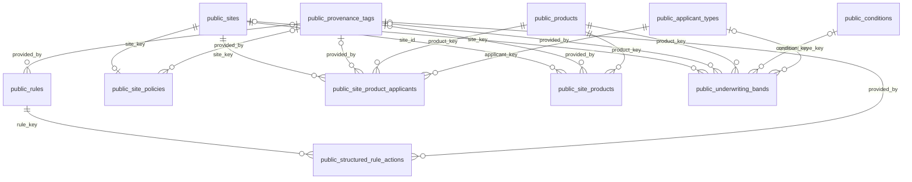

## analytics 1

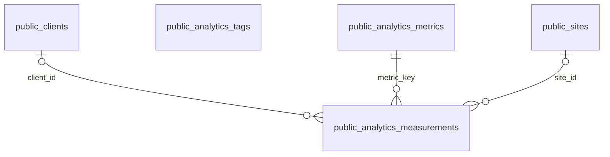

## catalog 1

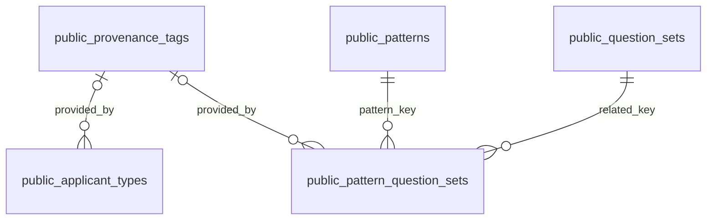

## applications 1

```mermaid
erDiagram
  public_applicants
  public_application_answers
  public_application_applicants
  public_application_associations
  public_application_coverages
  public_application_events
  public_application_participants
  public_application_riders
  public_application_snapshots
  public_applications
  public_clients ||--o{ public_applicants : "client_id"
  public_application_applicants |o--o{ public_application_answers : "application_applicant_id+application_id"
  public_applications ||--o{ public_application_answers : "application_id"
  public_fields ||--o{ public_application_answers : "field_key"
  public_applicants ||--o{ public_application_applicants : "applicant_id+client_id"
  public_applicant_types ||--o{ public_application_applicants : "applicant_type_key"
  public_applications ||--o{ public_application_applicants : "application_id+site_id"
  public_sites ||--o{ public_application_applicants : "site_id+client_id"
  public_site_association_contexts |o--o{ public_application_associations : "site_id+association_entity_id"
  public_applications ||--o| public_application_associations : "application_id+site_id"
  public_association_entities |o--o{ public_application_associations : "association_entity_id"
  public_sites ||--o{ public_application_associations : "site_id+site_key"
  public_site_associations |o--o{ public_application_associations : "site_key+association_key"
  public_application_applicants |o--o{ public_application_coverages : "application_applicant_id+application_id+applicant_type_key"
  public_applicant_types ||--o{ public_application_coverages : "applicant_type_key"
  public_application_applicants |o--o{ public_application_coverages : "application_applicant_id+application_id"
  public_application_associations |o--o{ public_application_coverages : "application_id+association_entity_id"
  public_applications ||--o{ public_application_coverages : "application_id+site_id"
  public_site_products ||--o{ public_application_coverages : "site_id+product_key"
  public_portal_actors ||--o{ public_application_events : "actor_id"
  public_applications ||--o{ public_application_events : "application_id"
  public_portal_actors |o--o{ public_application_events : "from_owner_actor_id"
  public_portal_actors |o--o{ public_application_events : "to_owner_actor_id"
  public_portal_actors |o--o{ public_application_participants : "actor_id"
  public_applications ||--o{ public_application_participants : "application_id"
  public_users |o--o{ public_application_participants : "user_id"
  public_application_applicants |o--o{ public_application_participants : "application_applicant_id+application_id"
  public_application_coverages ||--o{ public_application_riders : "application_coverage_id+application_id+product_key"
  public_product_riders ||--o{ public_application_riders : "product_rider_id+product_key+rider_key"
  public_application_associations |o--o{ public_application_snapshots : "application_id+association_entity_id"
  public_applications ||--o{ public_application_snapshots : "application_id+site_id"
  public_association_entities |o--o{ public_application_snapshots : "association_entity_id"
  public_portal_actors ||--o{ public_application_snapshots : "captured_by"
  public_portal_library_releases ||--o{ public_application_snapshots : "configuration_release_id"
  public_portal_library_releases ||--o{ public_application_snapshots : "configuration_release_id+site_key"
  public_sites ||--o{ public_application_snapshots : "site_id+site_key"
  public_site_products |o--o{ public_applications : "site_id+product_catalog_key"
  public_portal_actors |o--o{ public_applications : "current_action_owner_id"
  public_products |o--o{ public_applications : "product_catalog_key"
  public_sites ||--o{ public_applications : "site_id"
```

## hierarchy 1

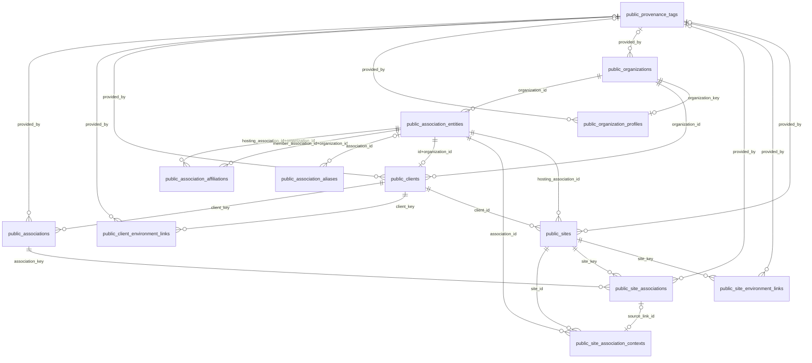

## hierarchy 2

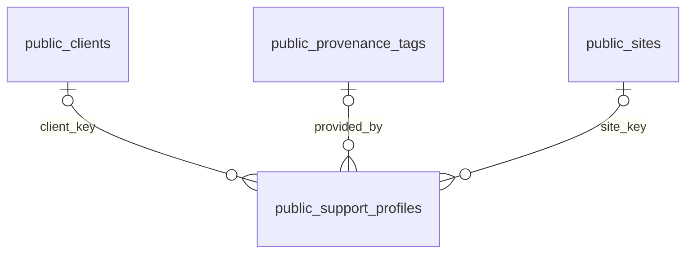

## changes 1

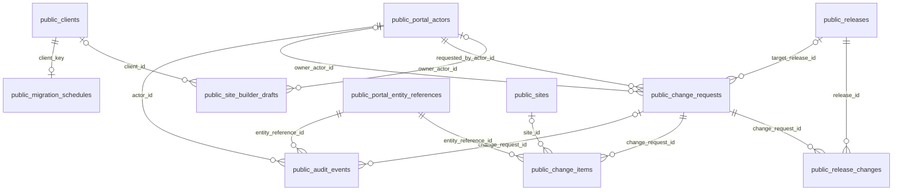

## library-themes 1

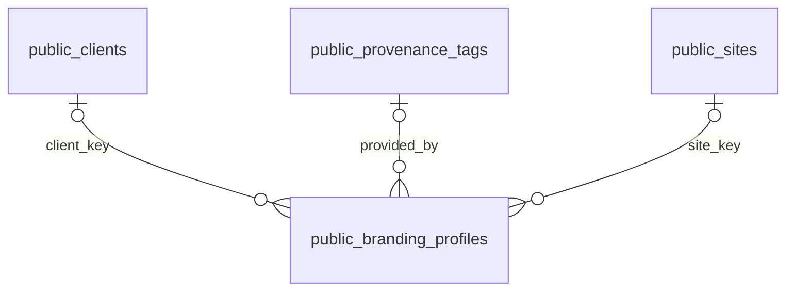

## library-components 1

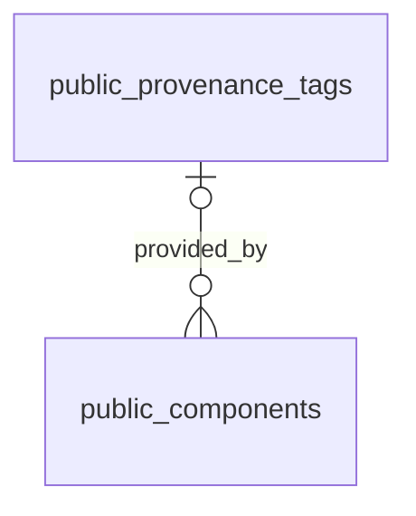

## library-configurations 1

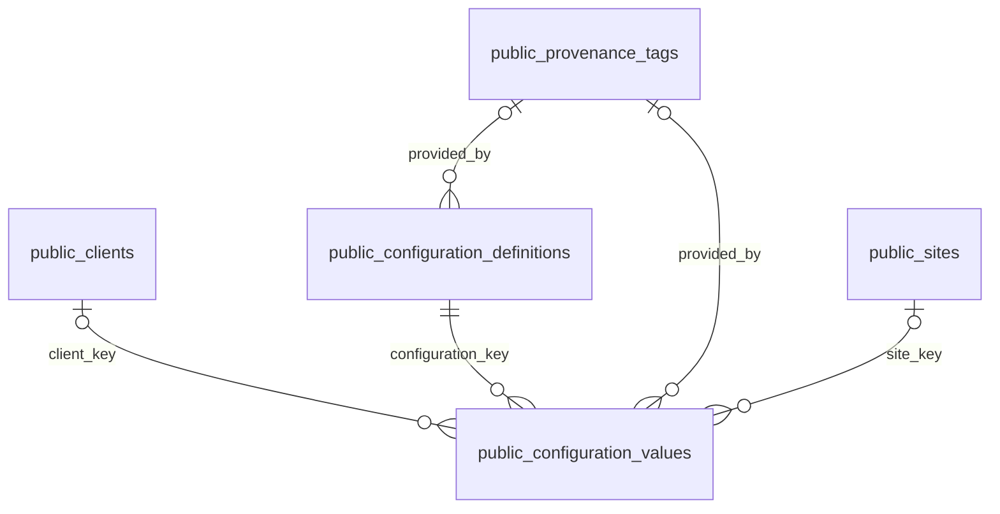

## library-content 1

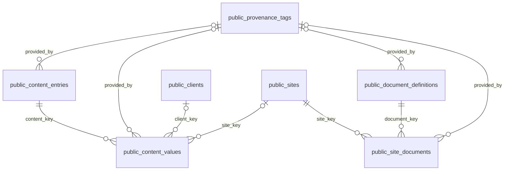

## library-products 1

```mermaid
erDiagram
  public_coverage_categories
  public_coverage_plan_definitions
  public_coverage_plan_variants
  public_product_configuration_values
  public_product_coverage_plans
  public_product_identifiers
  public_product_riders
  public_products
  public_riders
  public_site_riders
  public_provenance_tags |o--o{ public_coverage_categories : "provided_by"
  public_provenance_tags |o--o{ public_coverage_plan_definitions : "provided_by"
  public_applicant_types |o--o{ public_coverage_plan_variants : "applicant_type_key"
  public_coverage_plan_definitions ||--o{ public_coverage_plan_variants : "plan_key"
  public_provenance_tags |o--o{ public_coverage_plan_variants : "provided_by"
  public_configuration_definitions ||--o{ public_product_configuration_values : "configuration_key"
  public_products ||--o{ public_product_configuration_values : "product_key"
  public_provenance_tags |o--o{ public_product_configuration_values : "provided_by"
  public_applicant_types ||--o{ public_product_coverage_plans : "applicant_type_key"
  public_coverage_plan_definitions ||--o{ public_product_coverage_plans : "plan_key"
  public_products ||--o{ public_product_coverage_plans : "product_key"
  public_provenance_tags |o--o{ public_product_coverage_plans : "provided_by"
  public_clients |o--o{ public_product_identifiers : "client_key"
  public_products ||--o{ public_product_identifiers : "product_key"
  public_provenance_tags |o--o{ public_product_identifiers : "provided_by"
  public_sites |o--o{ public_product_identifiers : "site_key"
  public_clients |o--o{ public_product_riders : "client_key"
  public_products ||--o{ public_product_riders : "product_key"
  public_provenance_tags |o--o{ public_product_riders : "provided_by"
  public_riders ||--o{ public_product_riders : "rider_key"
  public_sites |o--o{ public_product_riders : "site_key"
  public_coverage_categories ||--o{ public_products : "category_key"
  public_provenance_tags |o--o{ public_products : "provided_by"
  public_provenance_tags |o--o{ public_riders : "provided_by"
  public_provenance_tags |o--o{ public_site_riders : "provided_by"
  public_riders ||--o{ public_site_riders : "rider_key"
  public_sites ||--o{ public_site_riders : "site_id"
```

## library-communications 1

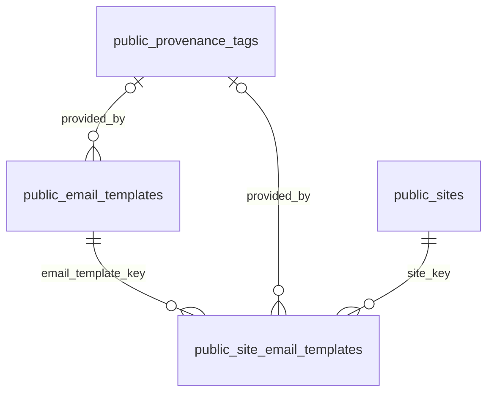

## library-features 1

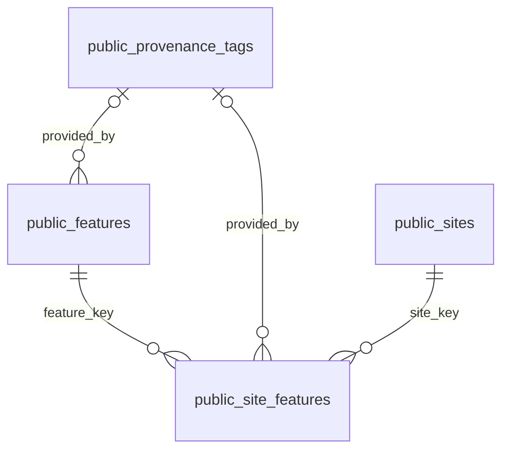

## library-fields 1

```mermaid
erDiagram
  public_fields
  public_page_fields
  public_page_section_fields
  public_product_question_sets
  public_question_definitions
  public_question_set_fields
  public_question_set_questions
  public_question_sets
  public_site_field_configurations
  public_provenance_tags |o--o{ public_fields : "provided_by"
  public_fields ||--o{ public_page_fields : "field_key"
  public_pages ||--o{ public_page_fields : "page_key"
  public_provenance_tags |o--o{ public_page_fields : "provided_by"
  public_fields ||--o{ public_page_section_fields : "field_key"
  public_provenance_tags |o--o{ public_page_section_fields : "provided_by"
  public_page_sections ||--o{ public_page_section_fields : "section_key"
  public_applicant_types |o--o{ public_product_question_sets : "applicant_type_key"
  public_products ||--o{ public_product_question_sets : "product_key"
  public_provenance_tags |o--o{ public_product_question_sets : "provided_by"
  public_question_sets ||--o{ public_product_question_sets : "question_set_key"
  public_provenance_tags |o--o{ public_question_definitions : "provided_by"
  public_conditions |o--o{ public_question_set_fields : "condition_key"
  public_fields ||--o{ public_question_set_fields : "field_key"
  public_provenance_tags |o--o{ public_question_set_fields : "provided_by"
  public_question_sets ||--o{ public_question_set_fields : "question_set_key"
  public_conditions |o--o{ public_question_set_questions : "condition_key"
  public_provenance_tags |o--o{ public_question_set_questions : "provided_by"
  public_question_definitions ||--o{ public_question_set_questions : "question_key"
  public_question_sets ||--o{ public_question_set_questions : "question_set_key"
  public_provenance_tags |o--o{ public_question_sets : "provided_by"
  public_clients |o--o{ public_site_field_configurations : "client_key"
  public_fields ||--o{ public_site_field_configurations : "field_key"
  public_pages ||--o{ public_site_field_configurations : "page_key"
  public_provenance_tags |o--o{ public_site_field_configurations : "provided_by"
  public_sites |o--o{ public_site_field_configurations : "site_key"
```

## library-shared 1

```mermaid
erDiagram
  public_flag_assignments
  public_flag_definitions
  public_flag_rules
  public_flag_values
  public_pattern_assignments
  public_pattern_conditions
  public_pattern_configuration_definitions
  public_pattern_coverage_categories
  public_pattern_flag_definitions
  public_pattern_flows
  public_pattern_products
  public_pattern_rules
  public_applicant_types |o--o{ public_flag_assignments : "applicant_key"
  public_applications |o--o{ public_flag_assignments : "application_id"
  public_clients |o--o{ public_flag_assignments : "client_key"
  public_coverage_categories |o--o{ public_flag_assignments : "coverage_key"
  public_flag_definitions ||--o{ public_flag_assignments : "flag_key"
  public_products |o--o{ public_flag_assignments : "product_key"
  public_provenance_tags |o--o{ public_flag_assignments : "provided_by"
  public_riders |o--o{ public_flag_assignments : "rider_key"
  public_sites |o--o{ public_flag_assignments : "site_key"
  public_provenance_tags |o--o{ public_flag_definitions : "provided_by"
  public_conditions ||--o{ public_flag_rules : "condition_key"
  public_flag_definitions ||--o{ public_flag_rules : "flag_key"
  public_provenance_tags |o--o{ public_flag_rules : "provided_by"
  public_flag_definitions ||--o{ public_flag_values : "flag_key"
  public_provenance_tags |o--o{ public_flag_values : "provided_by"
  public_applicant_types |o--o{ public_pattern_assignments : "applicant_key"
  public_clients |o--o{ public_pattern_assignments : "client_key"
  public_patterns ||--o{ public_pattern_assignments : "pattern_key"
  public_products |o--o{ public_pattern_assignments : "product_key"
  public_provenance_tags |o--o{ public_pattern_assignments : "provided_by"
  public_sites |o--o{ public_pattern_assignments : "site_key"
  public_patterns ||--o{ public_pattern_conditions : "pattern_key"
  public_provenance_tags |o--o{ public_pattern_conditions : "provided_by"
  public_conditions ||--o{ public_pattern_conditions : "related_key"
  public_patterns ||--o{ public_pattern_configuration_definitions : "pattern_key"
  public_provenance_tags |o--o{ public_pattern_configuration_definitions : "provided_by"
  public_configuration_definitions ||--o{ public_pattern_configuration_definitions : "related_key"
  public_patterns ||--o{ public_pattern_coverage_categories : "pattern_key"
  public_provenance_tags |o--o{ public_pattern_coverage_categories : "provided_by"
  public_coverage_categories ||--o{ public_pattern_coverage_categories : "related_key"
  public_patterns ||--o{ public_pattern_flag_definitions : "pattern_key"
  public_provenance_tags |o--o{ public_pattern_flag_definitions : "provided_by"
  public_flag_definitions ||--o{ public_pattern_flag_definitions : "related_key"
  public_patterns ||--o{ public_pattern_flows : "pattern_key"
  public_provenance_tags |o--o{ public_pattern_flows : "provided_by"
  public_flows ||--o{ public_pattern_flows : "related_key"
  public_patterns ||--o{ public_pattern_products : "pattern_key"
  public_provenance_tags |o--o{ public_pattern_products : "provided_by"
  public_products ||--o{ public_pattern_products : "related_key"
  public_patterns ||--o{ public_pattern_rules : "pattern_key"
  public_provenance_tags |o--o{ public_pattern_rules : "provided_by"
  public_rules ||--o{ public_pattern_rules : "related_key"
```

## library-shared 2

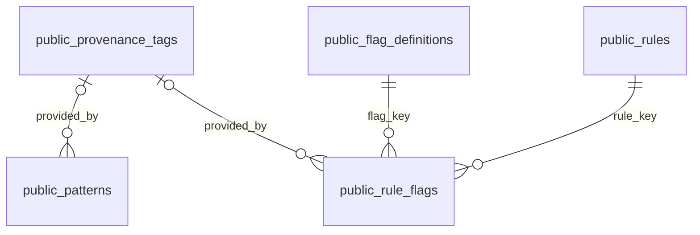

## library-flows 1

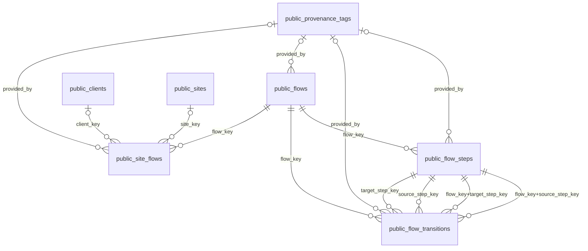

## evidence 1

```mermaid
erDiagram
  public_identity_resolutions
  public_portal_entity_references
  public_portal_reference_types
  public_provenance_tags
  public_requirement_targets
  public_schema_reconciliation_issues
  public_source_requirements
  public_source_sheets
  public_source_workbooks
  public_url_definitions
  public_url_usages
  public_products |o--o{ public_identity_resolutions : "product_key"
  public_provenance_tags |o--o{ public_identity_resolutions : "provided_by"
  public_source_sheets ||--o{ public_identity_resolutions : "sheet_key"
  public_portal_reference_types ||--o{ public_portal_entity_references : "reference_type_id"
  public_provenance_tags |o--o{ public_provenance_tags : "provided_by"
  public_provenance_tags |o--o{ public_requirement_targets : "provided_by"
  public_source_requirements ||--o{ public_requirement_targets : "requirement_key"
  public_provenance_tags |o--o{ public_source_requirements : "provided_by"
  public_source_sheets ||--o{ public_source_requirements : "sheet_key"
  public_provenance_tags |o--o{ public_source_sheets : "provided_by"
  public_source_workbooks ||--o{ public_source_sheets : "workbook_key"
  public_provenance_tags |o--o{ public_source_workbooks : "provided_by"
  public_provenance_tags |o--o{ public_url_definitions : "provided_by"
  public_clients |o--o{ public_url_usages : "client_key"
  public_provenance_tags |o--o{ public_url_usages : "provided_by"
  public_url_definitions ||--o{ public_url_usages : "url_key"
```

## library-pages 1

```mermaid
erDiagram
  public_page_sections
  public_pages
  public_site_pages
  public_pages ||--o{ public_page_sections : "page_key"
  public_provenance_tags |o--o{ public_page_sections : "provided_by"
  public_provenance_tags |o--o{ public_pages : "provided_by"
  public_pages ||--o{ public_site_pages : "page_key"
  public_provenance_tags |o--o{ public_site_pages : "provided_by"
  public_sites ||--o{ public_site_pages : "site_key"
```

## identity 1

```mermaid
erDiagram
  public_portal_actors
  public_portal_admin_accounts
  public_roles
  public_user_roles
  public_user_scopes
  public_users
  public_applicants |o--o| public_portal_actors : "applicant_id"
  auth_users |o--o| public_portal_actors : "auth_user_id"
  public_users |o--o| public_portal_actors : "user_id"
  auth_users ||--o| public_portal_admin_accounts : "user_id"
  public_roles ||--o{ public_user_roles : "role_id"
  public_users ||--o{ public_user_roles : "user_id"
  public_portal_entity_references |o--o{ public_user_scopes : "target_reference_id"
  public_users ||--o{ public_user_scopes : "user_id"
```

## publication 1

```mermaid
erDiagram
  public_portal_library_drafts
  public_portal_library_heads
  public_portal_library_publication_audit
  public_portal_library_readiness
  public_portal_library_releases
  public_portal_library_releases |o--o{ public_portal_library_drafts : "base_release_id"
  public_portal_library_releases |o--o{ public_portal_library_drafts : "base_release_id+site_key"
  auth_users ||--o{ public_portal_library_drafts : "owner_id"
  public_sites ||--o{ public_portal_library_drafts : "site_key"
  public_portal_library_releases |o--o| public_portal_library_heads : "release_id+site_key"
  public_portal_library_releases |o--o{ public_portal_library_heads : "release_id"
  public_sites ||--o| public_portal_library_heads : "site_key"
  public_portal_library_drafts |o--o{ public_portal_library_publication_audit : "draft_id+site_key"
  public_portal_library_releases |o--o{ public_portal_library_publication_audit : "previous_release_id+site_key"
  public_portal_library_releases |o--o{ public_portal_library_publication_audit : "release_id+site_key"
  auth_users ||--o{ public_portal_library_publication_audit : "actor_id"
  public_portal_library_drafts |o--o{ public_portal_library_publication_audit : "draft_id"
  public_portal_library_releases |o--o{ public_portal_library_publication_audit : "previous_release_id"
  public_portal_library_releases |o--o{ public_portal_library_publication_audit : "release_id"
  public_sites ||--o{ public_portal_library_publication_audit : "site_key"
  public_sites ||--o{ public_portal_library_readiness : "site_key"
  public_portal_library_drafts ||--o{ public_portal_library_releases : "draft_id"
  auth_users ||--o{ public_portal_library_releases : "published_by"
  public_sites ||--o{ public_portal_library_releases : "site_key"
  public_portal_library_drafts ||--o{ public_portal_library_releases : "draft_id+site_key"
```

## compatibility 1

```mermaid
erDiagram
  public_product_clients
  public_site_configurations
  public_site_coverages
  public_clients ||--o{ public_product_clients : "client_key"
  public_products ||--o{ public_product_clients : "product_key"
  public_provenance_tags |o--o{ public_product_clients : "provided_by"
  public_sites ||--o{ public_site_configurations : "site_id"
  public_products ||--o{ public_site_coverages : "coverage_key"
  public_provenance_tags |o--o{ public_site_coverages : "provided_by"
  public_sites ||--o{ public_site_coverages : "site_id"
```

## library-evidence 1

```mermaid
erDiagram
  public_semantic_requirements
  public_provenance_tags |o--o{ public_semantic_requirements : "provided_by"
```

## library-url-parameters 1

```mermaid
erDiagram
  public_site_url_parameters
  public_url_parameter_values
  public_url_parameters
  public_provenance_tags |o--o{ public_site_url_parameters : "provided_by"
  public_sites ||--o{ public_site_url_parameters : "site_key"
  public_url_parameters ||--o{ public_site_url_parameters : "url_parameter_key"
  public_provenance_tags |o--o{ public_url_parameter_values : "provided_by"
  public_url_parameters ||--o{ public_url_parameter_values : "url_parameter_key"
  public_provenance_tags |o--o{ public_url_parameters : "provided_by"
```

## library-validation 1

```mermaid
erDiagram
  public_validation_rules
  public_fields ||--o{ public_validation_rules : "field_key"
  public_provenance_tags |o--o{ public_validation_rules : "provided_by"
```
