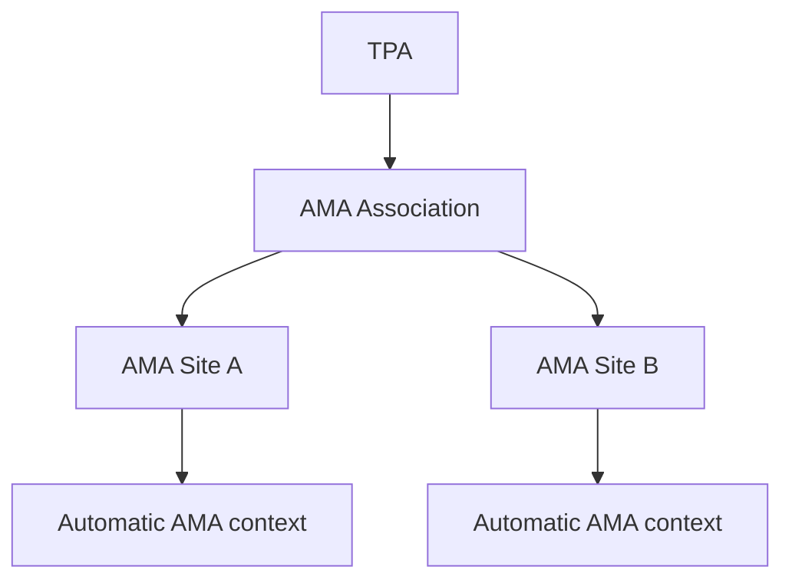
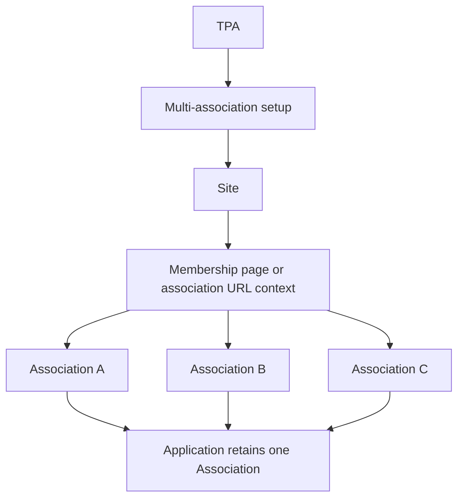

# Association and Site storage mapping

The confirmed business hierarchy is **TPA → Association → Site**. A TPA can have several Associations, and an Association can have several Sites. AMA is one Association with multiple possible Sites and no association selector. A multi-association Site supplies an association through the membership page or association URL context. Each Application retains at most one Association.

This document proposes the storage mapping for that hierarchy. It does not rename tables, merge records, change runtime behavior or apply migrations. [The complete crosswalk](hierarchy-crosswalk.md) and [source identities](hierarchy-crosswalk.json) preserve current records and the decisions still needed.

## Separate Association identity from Site selection behavior

An Association's identity and a Site's selection behavior are different things. A Site can have a fixed Association without asking the applicant to select anything. A multi-association Site has an explicit set of available Associations and resolves one of them.

The current `template_type = 'single' | 'multi'` describes page/form layout. It does **not** determine whether a Site serves one or multiple Associations. That distinction needs its own contract. The current fixed/select/url-parameter selection policy provides evidence of the intended association context.

For AMA, the automatic Site–AMA relationship supplies the application context. There is no separate “AMA membership option” identity and no membership selector. A persisted Site–AMA relationship is a context link, not a request for the user to choose AMA.

## Proposed canonical entities

| Entity or relationship | Meaning | Existing data to reconcile |
| --- | --- | --- |
| TPA | Administrator of Associations | `organizations`, its type and `organization_profiles`; provisional TPAs retain their unresolved status |
| Association | One canonical identity for an Association under a TPA, including the top-level multi-association setup where present | Hosting identity currently in `clients`; fixed-context or affiliated identities currently in `associations` |
| Association affiliation | Explicit relationship between a multi-association setup and the Associations it serves | Current `associations.client_key`; only validated distinct member identities become affiliations |
| Site | Portal experience under its hosting Association | `sites.client_id` points to the hosting identity today |
| Site–Association context | Association available or fixed on a Site | `site_associations`; retain enabled state, order and original relationship identity |
| Application Association | The one Association resolved for an Application | `application_associations`; retain the at-most-one constraint |

The proposal uses one canonical Association identity space. Additional profile and affiliation tables describe those identities and relationships; they do not introduce a business Client entity. “Hosting Association” is a descriptive role here, not a new hierarchy level.

An Association may appear on several Sites. A multi-association Site may offer several Associations. Keep these links explicit; do not replace them with a single `sites.selected_association_id` that would conflate configuration with an applicant's selection.

Affiliation cardinality must support reuse without silently imposing a one-to-one relationship. Whether reuse across different TPA owners is valid has not been established. Cross-TPA links remain unresolved rather than accepted by default.

## Proposed keys and invariants

- Each Site has one hosting Association. The hosting Association establishes inherited configuration and TPA context.
- Each canonical Association has an opaque identity distinct from its display name, acronym and aliases. Live UUID identities must be inspected before choosing migration mappings; export string IDs are not evidence of deployed UUIDs.
- The same canonical Association can be linked to several Sites. A Site/Association context pair is unique.
- Automatic context names one fixed Association and displays no selector. Membership-page or URL context must resolve to an enabled Association explicitly available on that Site.
- The fixed Association for an AMA Site is AMA itself. Canonicalizing its duplicate profile must not manufacture another Association identity or user choice.
- A multi-association Site's available Associations must be valid affiliates of its hosting setup. Parent ownership and affiliation changes must preserve that relationship, not only validate it when a Site link is first inserted.
- An Application may store at most one resolved Association. A historical selected or automatic context must remain identifiable after configuration changes.
- Minimum requirements at draft/submission stages, applicant ownership and historical snapshot storage remain application-model decisions. This mapping does not invent them.

These are proposed structural invariants. Composite constraints and any required discriminated validation will be specified once the identity crosswalk is resolved. The existing trigger's Client comparison is not the final business invariant.

## AMA mapping

The reviewed export contains:

| Current record | Meaning and proposed treatment |
| --- | --- |
| `clients.key = ama` | Candidate canonical AMA Association identity; carries the existing top-level ownership and configuration scope |
| `associations.key = american-medical-association` | Existing fixed AMA context/profile; candidate alias/profile reconciliation with AMA, preserving its original ID and attributes |
| `associations.key = mcr.association.ama.15` | Imported source row including AMA and GI/SI text; retain as source evidence until its attributes and identity are reconciled |
| `sites.key = ama` | Existing AMA Site; map hosting context to canonical AMA |
| Fixed Site–Association relationship | Automatic AMA context; preserve its relationship identity through the alias crosswalk |

The repository currently exports one AMA Site. The model supports multiple AMA Sites as confirmed by the user; no additional Sites are created to make the example appear in the current seed.

The imported AMA row is not a second selectable Association. Its text alone is also insufficient to create GI/SI Sites. Identity reconciliation must retain conflicting or variant information as evidence rather than discarding it through a name-based merge.



Site A/B illustrate supported cardinality, not a claim that two AMA rows already exist.

## Multi-association Site mapping

ISI Trust is an observed multi-association configuration in the repository. Its top-level record is currently `clients.key = isitrust`; its Site is configured for membership-page selection. That record's business name and TPA identity still require source reconciliation and are not established simply by the code's use of “Client.”

There are 25 enabled association identities assigned to the `isitrust` Site, including Akron Bar Association and Alabama State Bar. Those are distinct association candidates for the explicit affiliation and Site context relationships. A separate imported `mcr.association.isi.387` row is unassigned in the current export; it must not automatically become a 26th selectable Association.



This diagram illustrates the confirmed selection behavior. The individual canonical identities and affiliations are established through the crosswalk, not inferred from diagram labels.

## Complete existing record coverage

The file-only crosswalk covers 95 hosting Association candidates from `clients`, all 127 current lower `associations` rows, all 10 Sites and all 30 Site–Association links. Of the 95 hosting candidates, 86 have no Site in the reviewed export; they remain source-only candidates and are not activated.

The crosswalk classifies current association rows as offered on a multi-association Site, fixed Association context/profile, or unassigned evidence/definition. These are observations of existing policies and relationships. Only AMA's single-association behavior is explicitly confirmed by the business conversation; other fixed configurations are recorded as repository observations.

Seven hosting records have different TPA ownership between the local operational seed and reviewed migration export. These differences reflect distinct source paths, not necessarily corrupt data. Both values are retained. No TPA reassignment or merge is performed.

## Reference and contract changes this mapping will require

The [crosswalk](hierarchy-crosswalk.md#direct-scalar-ownership-impact) lists all 23 current direct ownership columns involving `client_id`, `client_key` or `organization_id`. The following cases need different treatment:

| Current storage surface | Target meaning or unresolved decision |
| --- | --- |
| `clients.organization_id` | TPA context of the canonical hosting Association |
| `sites.client_id` | Hosting Association identity |
| Existing Client-scoped configuration, branding, support, flow, rule and product relationships | Hosting Association scope, preserving current inheritance before any semantic change |
| `associations.client_key` | Reconciled profile/alias relationship for a singleton, or explicit affiliation for a distinct member Association |
| `site_associations` | Fixed context or available Association on a Site; policy determines selector behavior |
| `application_associations` | One actual resolved Association, with historical source identity retained |
| `applicants.client_id`, `application_applicants.client_id` | Applicant tenancy requires a decision between hosting context and actual resolved Association; empty applicant seeds do not settle it |
| `user_scopes.scope_type/scope_id` | Typed Association scope replacing the old Client label, with explicit target mapping |
| `site_policies.definition.associationSelection` | Fixed automatic context versus membership/URL context; keys must use the canonical crosswalk |
| `organization_profiles.definition.administrationContacts[].clientKey` | Contact's hosting Association reference |
| Audit/change/evidence target references | Preserve old table/key/ID identities through the crosswalk; do not replace arbitrary historical JSON strings globally |
| Publication payloads and saved application stores | Versioned identity interpretation; published historical data must remain readable |

Current scoped overrides refer to the old hosting `clients` record, not automatically to whichever Association an applicant selects. Reinterpreting all of those keys as selected member Associations would change inherited configuration and is not a safe rename.

Public asset paths such as `/client/ama/`, existing query aliases, and configuration filenames may remain compatibility paths during the transition. They are locators, not evidence of an additional business entity.

## Decisions retained as blockers

The business terminology and at-most-one application limit are settled. These record-specific and structural questions remain open:

1. Reconcile singleton profile/alias attributes and imported variant evidence before merging canonical identities.
2. Resolve the seven differing TPA mappings and provisional source TPAs against the intended database and authoritative records.
3. Determine the Association context for Sites currently lacking an association policy; do not infer a selector from how many source rows exist.
4. Decide applicant tenancy and its compatibility with a multi-association Site's resolved Association.
5. Confirm affiliation boundaries where an Association is shared outside its current hosting setup.

These blockers do not reopen AMA's no-selector behavior or the Application's one-Association limit. They identify the exact mappings that must be resolved before enforcing new constraints.

## Verification and implementation status

The current reviewed export integrity test passed. The crosswalk generator checks complete row coverage, unique source keys and the current AMA fixed-context policy. Syntax and targeted lint checks passed for the generator. Mapping validation does not prove that the proposed schema has been implemented or that a deployed database matches the exports.

No records were merged, removed, reassigned or activated. No runtime contract or migration was changed. The step 1 audit remains the record of the existing schema; this document is the proposed replacement ownership interpretation.

Reproduce the current crosswalk from the repository root:

```sh
MIGRATION_EXPORT_DIR=/tmp/portal-hierarchy-mapping npx vitest run src/migration/reviewedExport.test.ts
node scripts/map-association-hierarchy.mjs /tmp/portal-hierarchy-mapping
```
